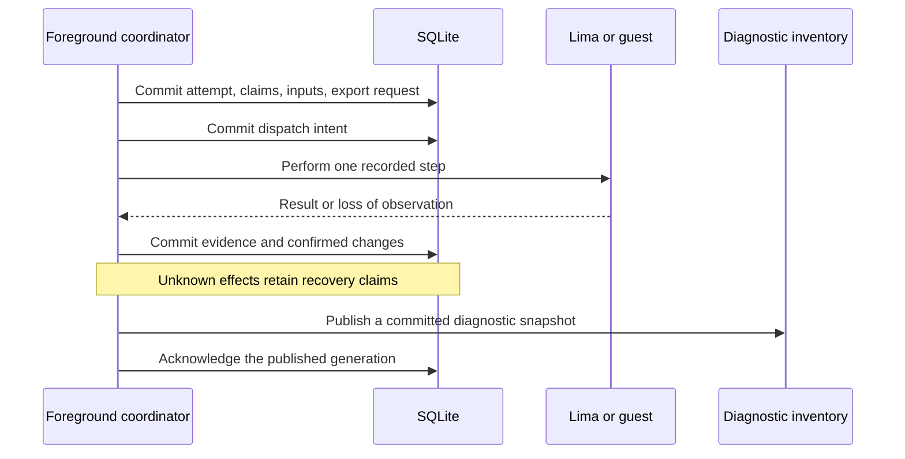
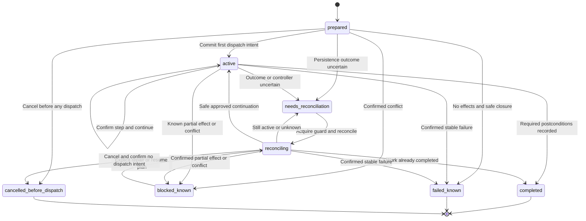

> Design record: this document predates implementation. For current behavior and validation, see the [user guides](../../README.md) and [test record](../testing.md). Historical status statements remain part of the decision trail.

# Detailed component contracts

This is the normative technical detail behind [the architecture and implementation plan](design_draft.md). T1–T14 preserve the selected component contracts; [STATE_CONTRACT.md](STATE_CONTRACT.md), [PROVISIONING.md](PROVISIONING.md), [ADOPTION.md](ADOPTION.md), and the identity/Lima supplements supply the exact protocols. [INTERFACE_V1.md](INTERFACE_V1.md) is the exact public contract approved on 2026-11-19. Comparison history is centralized in [DECISIONS.md](DECISIONS.md). Independent design re-review is complete; runtime qualification remains pending.

### T1: Host language and executable format

**Decision status:** accepted — Go standalone binary. The author selected Go and directed reuse of suitable scripts and test scenarios on 2026-11-18. Implement host behavior in Go; evaluate shell and guest-side scripts separately, and carry useful test scenarios into the new verification plan. Python host modules are references for porting behavior, not an embedded host runtime.

The [host-language decision record](DECISIONS.md#host-language) retains the alternatives.

### T2: Component boundaries and execution model

**Decision status:** accepted — foreground commands for v1. Each invocation hosts the shared operation logic. The author explicitly requires running VMs and profile SSH agents to remain available after the command exits. There is no persistent easy-lima management service.

The responsibility layout below carries forward under this execution model. Concrete package names, schemas, and method signatures still belong to the detailed implementation design. The alternative service model is retained below as comparison history.

The main boundary is between presenting a request, deciding and recording the operation, and performing external effects. Keeping those responsibilities separate allows CLI and TUI behavior to agree, diagnostics to remain read-only, and interruption tests to control each external effect.

The [component map](design_draft.md#component-map) assigns file/module ownership; the contracts below fix the interactions.

#### Contracts between components

The following are conceptual contracts, not final exported function signatures or CLI syntax:

| Contract | Input and result | Effect rule |
| --- | --- | --- |
| Resolve / inspect | A project reference or browsing root yields readable registration facts, observed VM state when available, and per-record problems. | Observation does not register a project or initialize storage. Absence and unavailability remain distinct. |
| Prepare | An action and requested settings yield intended inputs, affected resources, prerequisites, and changes available for preview. | Preparation does not execute provisioning or repair settings. Missing inputs are reported. The UI shows a preview wherever the accepted workflow requires it. |
| Execute | The requested action and its expected inputs yield an attempt reference, progress events, and a confirmed or unknown outcome. | Under coordination, recheck ownership, source/profile conflicts, input revisions, and applicable capacity before effects. A stale preview must be refreshed rather than applied to changed inputs. |
| Reconcile | A recorded attempt and observations yield evidence about active, completed, incomplete, or unknown work. | This belongs to an explicit retry/recovery workflow. Record observations without allocating a replacement VM; unknown outcome prevents replay. Read-only diagnostics may describe the evidence without rewriting it. |
| Diagnose | A check request yields a result for each check, including success, failure, unavailable, skipped, or unknown. | Use only read capabilities; no implicit VM start, profile unlock/initialization, or repair. |

Progress events carry step identifiers, outcomes, and approved operational details. Raw subprocess output is a separate stream: displaying it does not automatically put it in the operation journal or logs. Explicit raw capture keeps the accepted user-only access boundary. Secret-bearing arguments and environment values do not appear in generic error formatting.

For adapters using external commands, pass argument vectors rather than constructing host shell strings. Go's `os/exec` does not invoke a shell implicitly. Its default context cancellation targets the spawned process; it does not establish the outcome of work delegated to a VM. The design therefore treats cancellation and loss of observation separately from confirmed termination, as required by GF-07. [Go process execution](https://pkg.go.dev/os/exec).

The comparison evidence is retained in [the decision record](DECISIONS.md#execution-model).

#### Verification boundaries for this proposal

Reuse prototype scenarios where they protect current contracts: lazy traversal, source/path handling, ownership refusal, SSH-setting preservation, key isolation, and workload behavior. New tests must cover the gaps the review identified. The component boundaries make these checks possible without requiring a VM for every case:

- Run equivalent CLI and TUI requests against the same operation logic and compare intended actions, confirmations, and outcomes.
- Give diagnostics read-only dependencies; verify that absent Lima/storage and an invalid record retain useful partial results without triggering mutating calls.
- Inject interruption before and after external effects and before outcome recording. Reconcile the same instance and prove that uncertain completion prevents duplicate work.
- Verify that profile administration cannot call VM startup and that guest identity changes preserve user-owned settings and report conflicts.
- Verify structured events and default operational logs independently from raw output capture, including secret-bearing error paths.

Real-host release checks still cover Lima, SSH, VS Code, storage layouts, agent lifetime, and the shipped workloads. In particular, closing a completed command must leave the VM and selected agent usable from a fresh SSH or VS Code session. Killing a command during startup must produce a reconcilable attempt. No such tests have been run for this document.

### T3: Lima adapter design

**Decision status:** accepted — use the installed `limactl` CLI for v1. Lima remains an external dependency, and easy-lima checks compatibility explicitly. The author selected this integration on 2026-11-18. The alternative comparison is retained as design history. Exact supported versions and the implementation checks below still require validation; this decision does not change the foreground execution model or the accepted ownership and recovery rules.

#### Boundary and inputs

The adapter belongs within `internal/host/lima`. It translates between Lima and the application-owned request/result types. Only this adapter depends on Lima command syntax and output fields; Lima Go packages are not part of the selected application integration. Upstream output shapes and raw process errors do not become the registration schema or the public structured-output format.

The coordinator supplies the resolved storage namespace, the recorded instance name, the operation/attempt reference, the expected configuration inputs, and the deadline. For mutations, it also establishes ownership and coordination before calling the adapter. The adapter checks the target again and returns observations; it does not choose a project profile, allocate a new application registration, adopt an instance, or decide to retry. The application records evidence and controls subsequent steps.

Each invocation uses the configured `LIMA_HOME` and selected Lima installation explicitly. An unavailable namespace produces an unavailable result before commands that could initialize or write another location. Ambient root/template settings and SSH-agent choices must not silently change the target environment. The adapter supplies a controlled environment per subprocess invocation, using argument vectors rather than a shell command string. Cache and temporary destinations are still part of the separate capacity design.

Keep Lima's VM-access credentials distinct from a project's Git profile. The connection/identity components add the selected profile's forwarding to the managed SSH path. Bootstrap/provisioning control must not accidentally forward a personal host agent. User guest commands that require the profile use the corresponding connection contract; declaring a command a diagnostic must never implicitly start the VM or initialize an agent.

The normative [Lima boundary contract](LIMA_BOUNDARIES.md) defines namespace inputs, VM host-key enrollment and explicit port exposure. V1 rejects semantic namespace-wide inputs when the operation consumes them, without changing shared files; native instance YAML remains supported within the recorded boundaries. Every consuming operation checks the retained namespace manifest before dispatch.

#### Required adapter operations

Names below describe internal contracts, not finalized Go signatures or public command names.

| Operation | Required behavior | Candidate CLI mapping |
| --- | --- | --- |
| Probe runtime | Report executable identity/version and whether required capabilities are supported. Keep readable local metadata available when Lima is missing or unsupported. | Version observation plus the selected release's capability contract. |
| Observe instances | Return application-owned observations, per-instance errors, and whether the requested result is complete. A successful, complete lookup in the verified namespace is required before reporting absence. | `limactl list --format=json`, optionally restricted to recorded names. |
| Validate prepared configuration | Check the prepared local configuration and report structured validity problems. A validation failure cannot create, boot, repair, or change the guest. Any command-side writes/default filling must be understood before exposing it as read-only. | `limactl validate` on a prepared local template, with only verified nonmutating options. |
| Create new instance | Use the reserved name and recorded inputs for an explicit create attempt. An existing instance is a conflict to reconcile, not permission to overwrite. Capacity admission precedes any materialization that can download or allocate. | `limactl create --name INSTANCE CONFIG`, with noninteractive operation. |
| Start existing instance | Require verified existing-instance evidence. Use its stored configuration without new resource/preset flags. Return observations of readiness separately from guest-tool or Git checks. A missing registered instance must not be silently recreated. | Guarded `limactl start INSTANCE`, with its VM host agent in the background; see the start-specific finding below. |
| Stop instance | Request graceful stop of the verified target and observe the outcome. A timeout is not permission to escalate automatically or allocate anything. | `limactl stop INSTANCE`; force is a separately requested action, if exposed. |
| Apply owned configuration change | Apply the explicit rebind/update change to the same target after checking expected configuration and required stopped state. Preserve unrelated custom settings or reject unsupported changes. Record enough evidence for recovery if the edit outcome is unknown. | T11 selects node-preserving changes to the owned native YAML fields, Lima validation of the staged candidate, and a guarded atomic replacement while stopped; no implicit start. |
| Delete instance | Act only after the coordinator establishes ownership and the requested deletion confirmation. Preserve the host source. Reconcile the observed outcome before removing application ownership records. | `limactl delete INSTANCE`; do not use force as a substitute for confirmation or recovery. |
| Describe connection | Return the instance's Lima-generated SSH configuration location and relevant observations. The connection component retains the registered alias and manages its own settings. | Read the supported generated SSH configuration location; avoid deprecated `show-ssh`. |

The documented JSON and name-filter interface is described by [Lima list](https://lima-vm.io/docs/reference/limactl_list/). Configuration/lifecycle mapping is grounded in [create](https://lima-vm.io/docs/reference/limactl_create/), [validate](https://lima-vm.io/docs/reference/limactl_validate/), [edit](https://lima-vm.io/docs/reference/limactl_edit/), [stop](https://lima-vm.io/docs/reference/limactl_stop/), and [delete](https://lima-vm.io/docs/reference/limactl_delete/). These mappings need tests against the versions eventually supported; the table does not establish that every nominally read-only command is free of initialization side effects.

`--tty=false` suppresses Lima's own interactive workflow; easy-lima remains responsible for its required previews and confirmations. If a workflow uses `limactl shell`, the adapter must control its startup and environment-propagation flags explicitly. It cannot use `--start` to turn a diagnostic or profile-only action into VM startup. [Lima CLI options](https://lima-vm.io/docs/reference/limactl/), [shell options](https://lima-vm.io/docs/reference/limactl_shell/).

#### Start-specific findings

Two details matter to the accepted design:

1. **Foreground wrapper, background VM host agent.** `limactl start --foreground` changes the host-agent lifetime. The adapter must use background host-agent operation while easy-lima supervises startup in the foreground. Command completion and subsequent process cleanup must leave the running VM available. [Start options](https://lima-vm.io/docs/reference/limactl_start/).
2. **Start can create.** Source inspection of Lima v2.2.1 shows that `loadOrCreateInstance` loads the default template when a named instance is absent. Passing only a name is not an existing-only primitive. Before starting, the adapter must verify the registration, namespace, instance configuration, and required disk evidence. An absent or unknown target stops the action. The implementation must test its guard strategy against the selected Lima versions. [Inspected source](https://github.com/lima-vm/lima/blob/v2.2.1/cmd/limactl/start.go#L216).

The source tag above is an evidence point, not the chosen minimum or maximum Lima version. A check followed by `start` is not atomic against an unrelated process deleting the instance between those steps. easy-lima's own mutations must coordinate; uncoordinated external mutation during an operation is not made safe by that lock. This limitation must remain explicit, and observable drift must stop progression. The supported start strategy must pass the T14 adapter qualification gate before managed VM mutations ship; do not invent an undocumented existing-only flag or claim that a preflight check eliminates the race.

#### Observations, failures, and cancellation

Return the transport result and the VM outcome separately. A successful process exit does not by itself mean that the guest tools, signing, or online account checks passed. A failed or timed-out mutation may already have changed the VM.

| Situation | Adapter result and coordinator behavior |
| --- | --- |
| Missing executable, unsupported version, or unavailable root before dispatch | Report the specific prerequisite problem and that this call did not start. Preserve other local diagnostic results. |
| Complete lookup confirms no instance | Report absence with the verified namespace and observation context. A registered environment requires explicit recovery, not creation through an ordinary start retry. |
| Malformed, partial, or unfamiliar output | Retain trustworthy parsed observations, mark affected fields/records unknown, and mark the observation incomplete. Never infer absence from a row that could not be read. |
| Ownership/configuration mismatch or missing required disk evidence | Refuse progression and describe the conflict without overwriting, resetting, or recreating the instance. |
| Mutation returns failure, timeout, disconnect, or cancellation | Preserve whether dispatch occurred, any confirmed observations, and the remaining uncertainty. The coordinator reconciles before replay; a generic adapter retry loop must not issue another mutation. |
| Stop/delete process exits but post-state cannot be observed | Keep the action outcome unknown and retain ownership/recovery evidence until reconciled. |

The process runner must drain output without making consumer rendering a prerequisite for command completion. Decode machine responses separately from display output; keep buffering and time limits bounded and report truncation/incompleteness truthfully. Operational events contain permitted step/result data. Raw streams are persisted only under the accepted opt-in capture policy. Lima and guest logs remain separately identified potentially sensitive artifacts.

Signal handling must target the foreground control operation, with clear limits on what is known to have stopped. It must not blindly kill a process group that could contain a persistent VM host agent or shared profile agent. The exact cancellation sequence and reconciliation evidence will be tested per supported host/driver; process exit alone cannot establish the guest operation's outcome.

The comparison evidence is retained in [the decision record](DECISIONS.md#lima-integration).

#### Explicit compatibility contract

Each easy-lima release must publish a tested Lima version range and host/driver combinations. The adapter needs a versioned contract for required flags, JSON fields, generated SSH configuration, configuration edits, startup behavior, and read-only observations. A version string alone is not proof that a particular response is valid. Neither an unlimited minimum-version check nor best-effort parsing of human tables establishes support.

Resolve the selected executable to an absolute path and report its version. Record the executable/version used by a mutating attempt so reconciliation can identify a changed runtime. Before dispatch, check that the runtime and required operation capabilities are supported. Missing, unparseable, or unsupported versions prevent mutations with an explanation of the detected version and required compatibility. Local registrations and diagnostic results remain readable; unavailable runtime checks receive their own status. Recheck changed runtime context before continuing an interrupted attempt rather than silently changing its command semantics.

Do not automatically install, upgrade, downgrade, or switch Lima to make a check pass. A later easy-lima release may change its compatibility table, but that does not change a VM's recorded templates, provision revision, or installed tools. Runtime compatibility and environment updates are separate concerns.

T14 selects Lima 2.2.1 as the initial qualification target. Advertise only exact versions that pass fixtures and supported-host checks, including the start/create hazard and initialization side effects described above. Unsupported or malformed output remains an observation failure even within a recognized version range.

#### Adapter verification plan

- Exercise missing, unparseable, unsupported, and changed runtime versions without falling back to another executable or storage namespace.
- Decode fixtures from each supported Lima version, including missing/extra fields, partial records, invalid JSON, complete absence, and unknown runtime states.
- Verify that discovery, validation, and diagnostics do not initialize storage, start a VM, or unlock/create an agent when prerequisites are unavailable.
- Verify target-name/root binding, collisions, missing registered instances and disks, custom configuration preservation, and the existing-instance start guard.
- Inject loss of observation before dispatch, during creation/start/edit/delete, and after an external change but before outcome recording. Confirm that the same attempt/instance is reconciled before retry.
- Verify that explicit root and credential handling cannot fall back to ambient personal settings or another storage destination, and that secret-bearing command failures do not enter default logs.
- On supported hosts, let startup finish and exit the command, then connect from a fresh SSH/VS Code session. Also interrupt startup and check the retained evidence without automatically killing the VM or profile agent.
- Check raw-output capture off/on separately from machine-response decoding and normal operational logging.

Research for this section used public documentation and a tagged source read.

### T4: Configuration and state persistence

**Decision status:** accepted — the author selected B, SQLite with a read-only recovery inventory, on 2026-11-18. SQLite is authoritative for managed state; the inventory is diagnostic-only and cannot authorize mutations or automatically reconstruct ownership. The alternative comparison is retained as design history. Configuration syntax, locations, and precedence are accepted in T5; T6–T7 and T12 select the driver, schema, transactions, and maintenance/recovery behavior, with explicit implementation validation gates.

#### Separate editable intent from recorded facts

| Information | Responsibility and contents | Authority boundary |
| --- | --- | --- |
| Native Lima configuration | Templates/YAML describe guest images, resources, mounts, and provisioning. | Retain Lima's configuration model; preserve custom settings or report an unsupported change. Reading a template does not execute it. |
| Shareable project configuration | References templates/presets and records project choices that are safe to share. A profile label can request a local binding. | Cannot select a host's actual storage root, import a personal identity, or authorize adoption. Profile labels require explicit local binding. |
| Local user configuration | Storage selection, selected Lima executable, editor/browsing preferences, creation defaults, and explicit profile definitions with Git identity and credential references. | Belongs to the user independently of CWD and binary location. Credentials and personal paths are not distributed in project examples. |
| Managed application state | Stable registrations, actual instance/SSH bindings, ownership evidence, applied input revisions, operation attempts, and evidence about settings owned by easy-lima. | Written through the coordinator. A project path, discovery result, or configuration edit does not create ownership or replace a registration. |
| Operational logs and optional raw captures | Permitted step/outcome events by default; raw streams only when requested. | Logs help diagnosis; they do not replace durable operation records or establish that a mutation completed. Raw captures remain separate, user-only artifacts. |

Private keys and passphrases never become application-state fields. Profile records may reference a host key location/unlock mechanism and public fingerprint. Known secret values are excluded from persisted operation inputs and default logs. The existing identity and raw-capture policies still apply; this separation is not a claim that arbitrary user scripts can be universally sanitized.

Small configuration, registration, and recovery metadata need to remain available when the VM volume is disconnected. The layout accepted in T5 keeps them in a user application location independent of the VM storage root. All new and adopted VM disks still use the single explicitly selected root. Setup must show the actual metadata, VM, cache, and temporary destinations; the metadata location must never become a fallback destination for disk images. T5 defines the platform defaults and override rules. A missing or unreadable metadata location is also an unavailable result, not permission to create a second empty registry.

#### Resolution rules preserved by the selected backend

Configuration for a new environment is resolved into a reviewable plan. The plan identifies the origin of relevant values, the selected profile or absence of one, actual paths, and the supported Lima context. Built-in defaults, user defaults, project settings, and explicit command choices need field-specific precedence; a generic merge must not let project configuration override host ownership or credential policy. T5 defines the syntax, discovery, and precedence rules.

Once an environment is registered, ordinary startup uses its recorded association and applied environment inputs. New defaults or edited project templates may be reported as differences but do not trigger tool upgrades, change identity, rebind a source, or choose another disk root. Those changes use the corresponding explicit workflow and preview. Retry uses the recorded inputs. Retain nonsecret resolved settings and content/revision references sufficient to detect changed templates and provisioning scripts; if the original inputs are unavailable, do not substitute the latest preset.

Previews carry the configuration and record revisions they inspected. Before applying a change, recheck those revisions and the owned settings involved. A stale preview or conflicting user edit requires a new plan or conflict resolution. CWD chooses a browsing context, not a new registry or identity namespace. Changing the configured storage root after registration cannot silently abandon existing bindings or relocate their disks.

#### Logical records and invariants

These are data responsibilities, not final filenames, SQL tables, or Go types.

| Record | Required information and invariant |
| --- | --- |
| Registry/storage identity | Schema and writer compatibility, stable registry identity, and the configured storage namespace binding. Paths alone do not prove that the expected volume or owner is present. |
| Project registration | Stable ID, source binding, actual Lima instance name, storage binding, stable SSH alias, optional profile ID, ownership state, and record revision. IDs and aliases survive explicit project rebinding; adoption retains the real existing names. |
| Profile definition and managed evidence | Stable profile reference, explicit Git name/email/expected account, host credential references, and separate evidence of agent/SSH/Git settings managed by easy-lima. Renaming a label must not silently select another identity. Cached agent observations are not proof that an agent is still available. |
| Environment revision | Resolved nonsecret inputs, template/provision revision references, owned-setting expectations, and known versus unknown provisioning history. Desired changes remain distinct from the last confirmed applied revision. |
| Operation attempt | Operation ID, affected registration/profile, reserved target, intended inputs and their revision, last confirmed stage, dispatch/outcome evidence, and log references. A process exit, expired timestamp, or missing PID does not by itself permit replay. |
| Handoff/rebind evidence | Old and proposed bindings, metadata backup references, ownership-transfer stages, and which changes are confirmed. Preserve enough information to reconcile the same instance after interruption. |
| Observations | Value, source, time, and per-check status. Recorded facts remain distinguishable from current observations; unavailable or unknown does not mean absent. |

Uniqueness and conflict checks apply to the actual instance binding, source registration, SSH alias, and registered parent/child profile overlaps. Pending operations reserve conflicting bindings too. A directory index or cached status accelerates lookup but cannot grant ownership. If damaged or incomplete records prevent a required ownership/overlap check, block that mutation and explain the missing evidence. An unrelated unavailable profile alone must not block other environments.

#### Coordination and interrupted writes

Foreground invocations share coordination. A short metadata critical section validates expected revisions, reserves affected resources, and durably records intent before any external mutation. Long Lima or SSH calls run outside the global metadata critical section, with the conflicting-operation claim retained. Record observations and the confirmed outcome afterward. SQLite transactions implement the short metadata commits; T6–T8 and T12 specify claims, execution guards, transitions, and maintenance admission.

An OS lock being released after a crash does not clear the durable attempt. The next command reconciles that attempt before taking over or retrying. If persistence fails before dispatch, do not dispatch. If it fails after dispatch, preserve uncertainty and reconcile; do not issue a replacement action to make the records look complete. No backend can atomically commit a database/file write together with a VM or guest-script effect. Arbitrary script rollback remains outside v1.

Readers must identify incomplete or changing records without repairing them. Coordination must not require a diagnostic command to initialize a registry, create lock files, migrate a schema, or modify recovery evidence. Metadata updates and operation records require a bounded retention/backup policy that keeps unresolved attempts and ownership handoffs recoverable; logs cannot grow without limit or prune the only remaining recovery evidence.

The comparison evidence is retained in [the decision record](DECISIONS.md#authoritative-state).

#### Schema evolution, diagnosis, and verification

Version user/project configuration and managed state separately. An unknown schema or incompatible writer version blocks writes with recovery/version guidance rather than resetting state. Reading status must not auto-migrate or restore backups. Before a mutating migration, preserve a consistent metadata backup; a backup restore must still reconcile ownership and existing resources rather than revive a former owner. T12 defines explicit maintenance triggers, ownership-aware downgrade checks, and recoverable restoration.

The selected backend must be verified against these scenarios:

- Open from a different CWD or installed-binary path and see the same registrations and profiles.
- Disconnect the VM drive or remove Lima; return local bindings and independent unavailable checks without fallback allocation or registry creation.
- Interrupt writes before intent is durable, after intent but before dispatch, during an external action, and after its effect but before result recording. Recover the same attempt and instance without duplicate execution.
- Race two foreground commands for the same VM, source/alias binding, overlapping profiles, or ownership handoff. Retain independent progress where no conflict exists.
- Damage one logical record, interrupt a SQLite transaction, exhaust metadata space, or deny write permission. Show readable records and block mutations whose required consistency cannot be established. Also test database unavailability and stale/missing inventory exports without allowing the inventory to authorize changes.
- Inspect a newer schema and interrupted migration without modifying files; reject conflicting downgrades/restores. Verify that known secrets do not enter state, operational logs, or recovery inventory.
- Edit configuration or owned SSH/Git/Lima settings after preview. Reject stale assumptions and preserve user changes. Start an existing VM after changing defaults and confirm that its environment is unchanged.

This section records the accepted backend direction and its required contracts and test scenarios.

### T5: Configuration syntax, locations, and precedence

**Decision status:** accepted — on 2026-11-18 the author selected A, TOML for easy-lima with native Lima YAML, and approved the proposed locations and precedence. The associated file-discovery and path rules are carried forward with that configuration contract. The alternative comparison is retained as history. T12 selects the parser and field schema. The complete draft includes implementation and verification work; runtime behavior has not yet been tested.

The comparison evidence is retained in [the decision record](DECISIONS.md#configuration-syntax).

The selected wrapper syntax is TOML, with `.toml` as the canonical extension and a TOML 1.0 language baseline, independently of the application's `schema_version`. Native Lima configuration remains YAML; wrapper YAML is not selected for v1. Do not auto-detect or merge both wrapper formats. Parser selection must demonstrate the intended validation and editing behavior. The comparison above does not apply wrapper restrictions to native Lima templates. [TOML specification](https://toml.io/en/v1.0.0), [YAML specification](https://yaml.org/spec/1.2.2/).

This project example illustrates the selected TOML syntax. The complete field/type/flag contract is in [INTERFACE_V1.md](INTERFACE_V1.md), approved on 2026-11-19; independent design re-review is complete. The identity label requests a local binding; it cannot supply credentials or silently select an account.

```toml
schema_version = 1

[environment]
template = "./dev/lima.yaml"
presets = ["development"]

[resources]
cpus = 4
memory = "8GiB"
disk = "80GiB"

[identity]
profile_label = "work"
```

Disk size here means a creation-time virtual maximum, not reserved or currently allocated capacity. A disk-size edit cannot resize an existing VM in v1. The selected profile is still optional; omitting the request does not inherit a host Git identity.

#### Accepted file responsibilities and locations

Wrapper files use `.toml`. Directory names are logical names used in this draft, not environment variables to be installed.

| Location | macOS default | Linux default |
| --- | --- | --- |
| User configuration directory | `~/Library/Application Support/easy-lima` | `${XDG_CONFIG_HOME}/easy-lima`, default `~/.config/easy-lima` |
| Managed state directory | `~/Library/Application Support/easy-lima/state` | `${XDG_STATE_HOME}/easy-lima`, default `~/.local/state/easy-lima` |
| Small disposable application cache, if needed | `~/Library/Caches/easy-lima` | `${XDG_CACHE_HOME}/easy-lima`, default `~/.cache/easy-lima` |
| Project configuration | `<selected-folder>/easy-lima.toml` | Same |
| VM storage | The single root explicitly selected during setup | Same rule; no inferred default from CWD |

Linux follows the XDG separation of configuration, state, and cache, with defaults when the variables are unset or empty. Go documents the corresponding macOS user configuration and cache directories. The macOS `state` subdirectory is an accepted application choice. [XDG Base Directory specification](https://specifications.freedesktop.org/basedir/latest/), [Go user configuration directory](https://pkg.go.dev/os#UserConfigDir), [Go user cache directory](https://pkg.go.dev/os#UserCacheDir).

Within those locations:

- `config.toml` holds explicit host settings and creation/UI defaults. It is not a registry of projects or operations.
- `profiles/<profile-id>.toml` holds each local profile's desired Git identity, public fingerprint, and host credential/unlock references. A separate file permits an invalid profile to be diagnosed without hiding valid profiles. SQLite holds committed bindings, applied revisions, and ownership evidence; editing a profile definition does not silently change an active VM's identity.
- `state.sqlite3` is the authoritative managed state. `recovery-inventory/<registration-id>.json` is the export location for only the diagnostic data defined in T4, with generation/time. Missing or stale exports do not become replacement state.
- `logs/`, opt-in `captures/`, and `backups/` live under the state directory with user-only access and bounded retention. Retain unresolved operation/handoff evidence. Retained nonsecret configuration inputs are small metadata artifacts, not copies of project trees or disk images.
- Lima's own configuration, disks, and related instance files remain under the configured VM storage namespace. Existing adopted credentials remain referenced in place; this layout does not relocate keys or change an adopted identity setup.

The cache row is for easy-lima's disposable application data only. It does not select Lima's image-download cache or large temporary-file destinations. Those must be established by the storage adapter, shown before allocation, and checked together with VM capacity. Never put disk images in the metadata directory because the VM root is unavailable.

These defaults keep metadata separate from an external VM volume. A user whose home or explicitly configured XDG locations are also unavailable gets partial results from whatever remains readable, not a promise of an independent copy. SQLite backups must be consistent backups; copying a live database file alone is not the backup design.

#### Accepted discovery and path rules

1. Determine user locations independently of CWD, then read user configuration and the selected project's configuration. SQLite's location comes from the platform state directory, not the project file or an alternative user configuration file. V1 does not expose multiple registries or a per-project state directory.
2. Discover a project file only in the selected folder. Do not walk upward and merge ancestor files, infer the Git root, or change the selected source because a parent has a configuration or registration. Selecting a grouping folder still creates one VM. An explicit project-config file selector can reuse a configuration elsewhere without changing which folder is being registered.
3. An explicit user-config file selector replaces the normal user file for that invocation; it does not overlay it or redirect SQLite, profile bindings, or the VM root. Local profile definitions remain in the user configuration directory. The approved public flag is `--config FILE`, specified in INTERFACE_V1.md. An explicitly requested but missing file is an error, not a fallback.
4. Resolve file-relative paths against the canonical directory of the file that declares them, and CLI-relative paths against the invocation's original CWD. Show resolved paths in the plan. Host storage and credential locations must resolve to absolute paths; support leading `~/` for the current user but no shell evaluation, command substitution, or general environment interpolation in wrapper values. Native Lima template resolution remains governed by supported Lima behavior and the final plan's safety checks.
5. Resolve the selected Lima executable to an absolute path. Ambient `LIMA_HOME`, host Git settings, or `SSH_AUTH_SOCK` cannot override the registered root or profile. The Lima/identity adapters receive their explicit context. There is no generic environment-variable layer that silently overrides every wrapper field.
6. Reject relative XDG directory values with a clear error rather than selecting a different registry silently. This is intentionally stricter than XDG's instruction to ignore invalid relative values. Changing HOME/XDG locations does not authorize initializing replacement state or taking over an existing root. Check registry and ownership evidence before mutations; initialization remains an explicit setup action.

A missing project file is valid: creation can use reviewed defaults. A malformed file produces a path and field/line diagnostic. Missing user configuration for an existing installation is not treated as first-time setup; commands needing the missing settings stop, while local registrations and diagnostic inventory remain readable. Directory browsing and config inspection neither create files nor execute configuration content.

#### Accepted precedence by field

There is no single precedence rule that lets command flags override every invariant. The following rules apply after parsing and validation.

| Field category | Resolution | Existing environment behavior |
| --- | --- | --- |
| Browsing and presentation | Explicit invocation choices, then user preferences, then application defaults; CWD is the default starting folder. | Changes selection/display only. No rebind or registry change. |
| Template and preset selection | Explicit creation choices, then project settings, then user creation defaults, then shipped defaults. An explicit list replaces a lower-priority list. | Retain the recorded selection/revision. New defaults or a changed project file are reported as differences. |
| Wrapper-supported resource fields | Resolve the selected native template as the baseline; apply user creation defaults, project settings, then explicit creation choices to supported fields. Show every override's source. | Start uses the applied revision. Environment update begins with that revision and previews explicitly requested changes; it does not reapply all current creation defaults. Unsupported changes, including disk resizing, are rejected. |
| Extra mounts and localhost port requests | Use the same wrapper-field order for complete lists; an explicit empty list clears lower-priority wrapper requests. Do not concatenate lists across layers or implicitly erase custom native-template entries. Validate the resulting plan and show every exposed path/port. | Apply only through an explicit supported change. The registered `/workspace` binding remains owned by rebind, not list precedence. |
| Storage root and state location | Root selection is host-local setup intent, checked against SQLite's committed namespace and ownership evidence. State location follows the bootstrap rules above. Project settings and ordinary per-VM flags cannot replace either. | A mismatch blocks affected storage mutations. No move, second root, or empty registry is created to satisfy configuration. Independent profile administration remains possible. |
| Identity | Explicit local selection/binding of a stable profile ID, or no profile. A project label is only a request shown to the user; matching a local label does not authorize binding. No automatic global or host-Git fallback. | Keep the recorded profile and applied identity revision. Replacement/repair is an explicit profile workflow, reports user-edit conflicts, and checks overlaps before changing assignments. |
| Lima executable and editor | Explicit supported invocation choice, then user setting; setup can discover an executable and record the selected path. Store editor arguments as structured values, not shell snippets. | Runtime compatibility is checked independently of guest revisions. An alternative config file cannot change ownership or silently switch credentials. |
| Instance name, SSH alias, ownership, applied revisions, attempt progress | Assigned or retained by the relevant managed workflow and committed to SQLite. These are not user/project override fields. | Preserve them through startup/retry/rebind; only their explicit workflows may change them. Inventory data never overrides SQLite. |

For example, a template with 2 CPUs, a user creation default of 4, a project request of 6, and an explicit creation choice of 8 resolves to 8. Without the explicit choice it resolves to 6. Once applied, changing the user default to 10 does not change that VM during startup.

Scalars replace scalars; wrapper lists replace whole lists and retain their declared order. Reject duplicate/conflicting entries, invalid units/types, unknown wrapper fields, and null values instead of guessing intent. Native Lima YAML is not recursively merged as arbitrary wrapper configuration. The eventual patch adapter must preserve custom content and either implement each owned override precisely or reject it. After all resolution, validate ownership, source/profile overlaps, explicit mounts/ports, storage placement, and compatibility again. Precedence cannot waive those rules.

Each resolved field has provenance: shipped/template origin, user/project file and field, explicit invocation choice, or recorded applied revision. A read-only configuration explanation should display the effective values and differences with sensitive values excluded. It must not fetch or run scripts, unlock keys, start VMs, repair files, or save raw configuration by default. Template materialization, where needed, belongs to the explicit operation plan and its capacity checks.

#### Editing and verification requirements

Configuration readers never rewrite files. Explicit configuration/profile actions update only owned fields, preserve unrelated user content, and report conflicts against the version read. TOML parser/round-trip behavior must be checked before promising comment preservation; unsupported edits should produce a reviewable change rather than rewrite the whole file. Schema versions for user, project, profile, database, and inventory formats are checked at their own boundaries.

During implementation, verify path anchoring with spaces/symlinks, malformed and duplicate fields, missing files, invalid XDG paths, distinct CWDs, same-label/different-ID profiles, and conflicting root selection. Test each precedence row, explicit empty lists, a changed file after preview, and ordinary startup after defaults/project settings change. Inspect with unavailable Lima/storage and an unreadable database without initializing directories or modifying the inventory. These are design scenarios, not completed runtime tests.

### T6: SQLite schema, transactions, and recovery inventory

**Decision status:** accepted journal direction — on 2026-11-18 the author selected B, WAL, with explicit checkpointing and preserved read-only diagnostics. SQLite remains authoritative and the inventory remains diagnostic-only. The relational schema, transaction boundaries, and export protocol below are selected under the delegated internal-design authority, with T7 operation semantics and T12 maintenance/runtime additions. Exact driver behavior and recovery transitions still require validation; no runtime implementation is claimed.

The complete additional tables, composite references, marker formats and publication/restore predicates are in [STATE_CONTRACT.md](STATE_CONTRACT.md). That supplement supplies ELD-13 and takes precedence over earlier shorthand table descriptions.

#### Proposed relational schema

Use stable, opaque text IDs independent of paths. Use integer revisions/generations for ordering and optimistic concurrency; timestamps are diagnostic information, never ownership leases. Keep keys, uniqueness rules, states, and references in typed columns. Use size-bounded, schema-validated JSON only for nonsecret resolved-input snapshots and structured evidence whose fields vary by operation. Do not store raw output, private keys, passphrases, or arbitrary process environments in these payloads.

Keep the state directory private to the user, including the database, journals, inventory, and temporary export files. On the supported POSIX hosts, use owner-only directory/file permissions and verify side-file behavior with the chosen driver.

The table names and columns below define the proposed model; they are not migration files or a completed SQL implementation. Required columns are non-null unless explicitly optional. Cross-record references use foreign keys, with deletion restricted where recovery/history depends on the referenced row.

| Table | Principal columns and relationships | Invariant |
| --- | --- | --- |
| `registry` | Singleton slot; `registry_id`, `schema_version`, `generation`, writer-compatibility metadata. | One authoritative registry. Relevant commits increment generation in the same transaction as the changed records; wall-clock time does not order commits. |
| `schema_migrations` | `version` primary key, migration checksum, completion time, consistent-backup reference. | Only a completed schema transaction advances the recorded version. A binary cannot silently rewrite an unknown/newer schema. |
| `storage_namespace` | Singleton slot; stable `namespace_id`, selected root, expected volume/root ownership evidence, row revision. | One configured namespace for new and adopted VMs. A path match alone is insufficient proof that the expected storage is present. |
| `profiles`, `profile_credential_revisions`, `profile_revisions` | Stable profile ID/label; committed credential and future-VM default identity references; membership generation; immutable shared credential revisions and credential-bound public guest-identity snapshots. | Desired TOML does not change active state. Credential changes include every member; per-VM guest settings remain pinned. [The profile-transition contract](PROFILE_TRANSITIONS.md#revision-model) specifies these fields and references. |
| `registrations` | Registration ID, namespace ID, actual Lima name, SSH alias, source path/comparison key, optional profile ID, optional applied environment revision, applied/pending profile revision and identity-operation references, ownership/lifecycle states, row revision, optional retirement time. | Covers planned, adopted, active, and retired registrations. NULL profile means no profile, not an inherited default. Names and aliases remain stable through rebind. |
| `environment_revisions` | Revision ID, owning registration ID, input schema/digest, resolved nonsecret input snapshot and immutable artifact references, provision revision, known/unknown history marker. | Immutable revisions distinguish desired work from confirmed applied inputs. The registration's applied revision must belong to that registration. Adoption can explicitly retain unknown history. |
| `operations` | Operation ID/kind, primary registration/profile scope, frozen input revision, optional retry-of and parent operation IDs, coordinator token, status, optional stop reason, last confirmed stage, runtime path/version, created/updated times, safe log references. | Durable attempt association precedes external effects. T7 distinguishes prepared, active, reconciliation-required/in-progress, known blocked, completed, known failure, and cancellation before dispatch; known failure is not blanket permission to replay. |
| `operation_steps` | Operation ID plus stage/dispatch ordinal, dispatch-intent state, separately observed effect state, bounded evidence, observation time, safe result code. | Each dispatch attempt has a durable entry. Process exit and confirmed guest effect are different facts. Retry adds reconciled evidence instead of overwriting an unknown attempt. |
| `resource_claims` | Operation ID, resource kind/key, shared or exclusive mode, coordinator token. | Claims survive command exit/crash until reconciled. Compatibility is checked inside the write transaction; no timeout or missing PID deletes a claim. |
| `binding_reservations` | Operation/registration IDs; proposed source comparison key/path and proposed optional profile binding, plus presence flags where NULL means an explicit profile-free target. | Reserve the proposed side of rebind/profile changes while retaining the current side. Check current and proposed bindings together before admitting another conflicting operation. |
| `owned_settings` | Registration/profile owner, target and field identifier, expected managed value or digest, applied revision, optional protected backup reference. | Detect edits to SSH/Git/Lima settings rather than overwrite user changes. Store scoped nonsecret evidence, not unrestricted host configuration dumps. |
| `binding_changes` | Operation/registration IDs, change kind, old/proposed binding snapshots, previous/new owner evidence, backup references, confirmed transition stage. | Adoption and rebind retain both sides through interruption. A completed database transaction cannot by itself prove that an external ownership marker or mount changed. |
| `inventory_exports` | Registration ID primary key, desired generation and minimal payload/digest, optional published generation/digest, optional safe last export error. | An export request is committed with the state it describes. Publication progress is separate from operation success; an older acknowledgment cannot clear a newer pending export. |

Enable and verify foreign-key enforcement on every relevant connection before transactions. Required references use explicit constraints; composite references prevent a registration or profile pointing to another owner's revision. SQLite provides foreign keys and table constraints, but enabling the feature and validating application invariants remain our responsibility. [Foreign keys](https://www.sqlite.org/foreignkeys.html), [table constraints](https://www.sqlite.org/lang_createtable.html).

Use unique indexes for live registrations' source comparison key, namespace/instance-name pair, and SSH alias. Planned/uncertain registrations count as live; only confirmed retirement removes their active uniqueness constraint. Retain the retired record as a tombstone. Partial unique indexes can express this without deleting history. [Partial indexes](https://www.sqlite.org/partialindex.html).

SQL uniqueness does not establish filesystem equivalence or parent/child relationships. The coordinator compares resolved path components using the supported filesystem's semantics, not string prefixes or naive lowercasing. Inside the same write transaction, check live registrations plus pending reservations for exact and parent/child profile conflicts, including current and proposed profile assignments. Missing source/ownership evidence blocks only mutations whose checks cannot be established. A nullable profile is an explicit profile-free binding for these comparisons.

Index foreign-key lookups, active operation/claim lookup, reservation lookup, and pending exports. Keep list queries bounded and decode per-registration payloads independently so one malformed logical record can be reported alongside others. A physically damaged database may still require the diagnostic inventory. Inventory acknowledgments update export bookkeeping without producing another inventory request indefinitely.

#### Transaction and executor boundaries

A short `BEGIN IMMEDIATE` transaction establishes the write boundary before checking revisions and reservations. SQLite permits one writer at a time; this mode obtains that position before the checks, rather than attempting a later read-to-write upgrade. Waits are bounded and cancellable. Retry a metadata transaction only when its rollback/no-effect outcome is known; never retry a Lima action because the metadata database was busy. [SQLite transaction modes](https://www.sqlite.org/lang_transaction.html).

Use a per-operation OS executor guard in addition to durable SQLite claims. It prevents two foreground commands from driving the same recorded attempt. The guard must not be inherited by persistent VM/profile agents. Its release makes reconciliation possible, not replay safe. A replacement coordinator obtains the guard, checks the previous attempt, and records a new coordinator token; subsequent state writes compare that token. This fences stale metadata writers, not an already dispatched Lima/guest action. If the external action remains active or unknown, the replacement does not dispatch conflicting work.

Never wait for an OS guard, invoke Lima/SSH, wait for guest readiness, unlock a key, write an inventory file, or render a TUI while holding a SQLite transaction. Requests for conflicting claims are checked atomically; unrelated VM work can progress between short commits. T7 selects the VM/profile claim rules and their recovery boundaries.

| Boundary | Atomic SQLite work | Work outside the transaction |
| --- | --- | --- |
| Prepare | Compare plan/record revisions; verify ownership and bindings; reserve resources; create operation/step intent; retain frozen input references; queue the affected inventory snapshot. Commit before dispatch. | Resolve/read prerequisites and prepare any small immutable nonsecret artifacts first. Artifact files must be durable before the database references them; unreferenced leftovers are not committed state. |
| Dispatch intent | With the executor guard held, recheck claims/token/expected revisions and mark that the next external step may be dispatched. Commit. | Call the external adapter. A crash between this commit and the call is deliberately treated as uncertain until reconciled; do not infer that the call occurred merely from the intent. |
| Observe | Record separate dispatch/process and external-effect evidence. Advance applied revisions or ownership only for confirmed changes. Increment affected revisions/generation and queue a new diagnostic snapshot. | Read target state through verified observers. A nonzero exit or timeout can still leave an external effect. |
| Finish | Mark a reconciled terminal outcome, retain required history, and release only claims that are safe to release. Publish a retirement tombstone only after deletion/ownership outcome is confirmed. | Return command results with independent VM, persistence, and inventory statuses. |
| Reconcile | Compare the existing operation, claims, coordinator token, and newly observed evidence; record the decision without allocating a replacement instance. | Inspect the same target. If evidence remains insufficient, stop with recovery instructions. |



A commit error is not automatically evidence that nothing committed. If the connection/driver cannot establish the outcome, reopen through the supported recovery path and query by the existing operation ID/token before proceeding. If persistence fails after an external action, report the observed action separately from the unrecorded/unknown result. Do not clear claims, switch to inventory-backed writes, repeat the external action, or initialize a new database.

#### Inventory contents and publication

Each `recovery-inventory/<registration-id>.json` contains a versioned, independently readable diagnostic snapshot: registry and registration IDs; snapshot generation/time; recorded source, instance, alias, namespace and expected paths; optional profile ID; recorded ownership/lifecycle status; unresolved operation IDs and last confirmed stages; and relevant log/backup locations. An interrupted rebind includes both recorded and proposed source paths. The file states that it is diagnostic-only. It contains no private credentials, full profile definitions, arbitrary scripts, raw command output, or executable recovery plan.

The inventory is an allowlisted projection of committed SQLite state. Its envelope includes a digest of the version-defined serialized payload; readers validate the format, bounded size, required fields, and digest independently for each file. A checksum detects mismatched/truncated publication; it is not proof of ownership or protection against a user editing the file. Filenames are derived from validated registration IDs under the fixed inventory directory, not from an arbitrary path in a payload.

Proposed publication protocol:

1. In the same transaction as a registration-relevant state change, replace that registration's desired export payload/generation in `inventory_exports`. Several rapid changes can coalesce to the latest desired snapshot. Keep the authoritative operation history separately.
2. After commit, an authorized writer obtains a bounded per-registration export guard. Read the latest desired snapshot from SQLite while holding that guard, then close the read transaction before filesystem work. Do not publish a snapshot captured before acquiring the guard.
3. Write a user-only temporary file in the inventory directory, synchronize it, replace the target atomically on the supported filesystem, and synchronize directory changes as required by that platform. Diagnostics see either a complete older file or a complete newer file. This is file publication, not a transaction spanning SQLite and the filesystem.
4. In a short transaction, acknowledge the generation/digest actually published. If a newer desired generation appeared meanwhile, leave it pending. Keep the export guard until acknowledgment or failure so another exporter cannot publish an older snapshot after a newer one.
5. A foreground mutation attempts its affected exports after commits, with bounded work. A later mutating command or explicit inventory-refresh action can drain pending exports. Read-only list/doctor never regenerates inventory. No background easy-lima daemon is introduced.

If publication fails, retain the pending request and report an inventory warning independently of the VM outcome. This proposal treats inventory availability as degraded diagnostics, not as an additional authority or an automatic rollback trigger. Once authoritative intent is durable and other preconditions pass, a failed export alone does not replay or undo the VM operation. An unwritable database, failed authoritative intent, or unresolved ownership still blocks dispatch.

If the file was published but acknowledgment failed, the request remains pending and can be exported again from SQLite. A file showing a foreign registry or an unexpectedly newer generation is a consistency diagnostic; do not import it, overwrite it blindly, or advance SQLite from its contents. Restore/recovery must use the explicit authoritative-state and ownership workflow. In particular, the inventory cannot mint claims, recreate registrations, or select a VM for a mutating command.

When SQLite is readable, compare each inventory generation/digest with its export row and report current, stale, missing, or invalid separately. When SQLite is unavailable, files provide last-known facts with unknown currentness and unknown collection completeness; an absent file does not prove that no registration or VM exists. Report export/snapshot time separately from any runtime observation time. After confirmed deletion, publish a tombstone so an older file does not continue to describe a live registration. When SQLite is readable, a file with no matching export record is an orphaned diagnostic artifact, never a live registration. Retention must preserve unresolved transitions and their tombstones; removal of retired rows/exports must not leave older files that appear current.

#### Read-only access, backups, and schema changes

Separate read-only inspection from the write/recovery connection path. Inspection must not create `state.sqlite3`, initialize directories, migrate schemas, update cached observations, create/clean up journal side files, recover a hot journal, checkpoint, or refresh exports. Use a verified read-only open strategy and bounded reads; neither `query_only` alone nor marking a live database `immutable` establishes this contract. If the selected driver cannot inspect safely, return readable inventory/local configuration and a separate unavailable/recovery-required database status. [SQLite URI open modes](https://www.sqlite.org/uri.html), [read-only recovery errors](https://www.sqlite.org/rescode.html#readonly_rollback).

Native journal recovery and schema changes must not be smuggled through diagnostics. A write-capable path requires an authorized mutation or explicit state recovery, known compatibility, and coordination. If those gates cannot be established, stop. Do not erase a damaged database, remove journal files, or restore a backup automatically to make opening succeed.

Before a schema migration, obtain exclusive registry maintenance coordination and make a consistent database backup, not a bare copy of a live main file. Use a supported SQLite snapshot/backup mechanism exposed by the selected driver; SQLite documents an online backup API for this purpose. Check the result before migration. [SQLite backup API](https://www.sqlite.org/backup.html).

A migration updates schema and version metadata in one transaction where supported by the planned change. It must preserve unresolved attempts/claims, ownership evidence, applied revisions, and pending exports. Stop if a required transformation cannot be made safely; a backup is not permission to discard these records. Resume interrupted export work after commit. Configuration-file changes, restores, and ownership-marker changes are separate journaled effects, not implicitly atomic with that schema transaction. T12 defines final migration admission, namespace publication, and recoverable restore transitions.

The comparison evidence is retained in [the decision record](DECISIONS.md#journal-mode).

#### Explicit checkpointing contract

Automatic threshold checkpoints and checkpoints on connection close are separate SQLite behaviors. Disable automatic threshold checkpoints on every physical connection with `wal_autocheckpoint=0`. Also require a verified equivalent of `SQLITE_DBCONFIG_NO_CKPT_ON_CLOSE=1`; disabling the threshold alone does not prevent the last connection from checkpointing during close. Check the returned setting rather than assume it worked. [Automatic checkpoints](https://www.sqlite.org/c3ref/wal_autocheckpoint.html), [checkpoint-on-close control](https://www.sqlite.org/c3ref/c_dbconfig_defensive.html#sqlitedbconfignockptonclose).

Map the accepted policy to the explicit `state checkpoint` action, whose approved spelling and options are specified in INTERFACE_V1.md. Ordinary start/list/doctor, inventory export, pool eviction, and process exit do not request a checkpoint. A selected driver must uphold this on normal and failed connection initialization/closure. Keeping a hidden long-lived process solely to hold a database connection open would contradict T2.

The maintenance action operates on the existing registry and reports the checkpoint mode, observed frame counts where available, and complete/partial/busy/error status. PASSIVE can make partial progress without waiting for readers/writers; FULL, RESTART, and TRUNCATE involve stronger waits and must be explicitly selected with bounded cancellation. A busy or partial result never automatically escalates to a stronger mode. Do not use a checkpoint pragma merely to collect diagnostic statistics. [Checkpoint modes](https://www.sqlite.org/c3ref/wal_checkpoint_v2.html).

Checkpoint coordination is metadata-only. It does not clear operation claims, establish guest readiness, or require all uncertain VM operations to be resolved first. SQLite's own locking handles concurrent metadata access; any application maintenance guard must not turn unresolved VM claims into a barrier to preserving database health. Required compatibility/ownership checks on the registry still apply.

Read-only diagnosis may report WAL file size and previously recorded maintenance results, clearly labeled, without opening a writer or invoking a checkpoint. Growth produces maintenance guidance or an insufficient-metadata-space error; it does not trigger hidden checkpointing, WAL deletion, or relocation. WAL/SHM files may remain after the foreground command exits. Their presence is not evidence of garbage or an active controller. The driver and host tests must verify that inspection does not create, recover, clean up, or checkpoint those files.

#### Required failure-injection checks

- Start two foreground operations that collide on a registration, alias, source, rebind target, or profile mutation. Admit only compatible claims; keep independent work available.
- Interrupt before the prepare commit, after dispatch intent but before the external call, during the call, after its effect, and during outcome commit. Reconcile the same operation/VM; never infer no effect from a missing completion record.
- Fail commits or lose the connection with an ambiguous result. Locate the attempt by stable ID/token before retry; do not create another registration or repeat an external step.
- Interrupt export before rename, after rename, and before acknowledgment; race two exporters with a newer database commit. Files remain complete, acknowledgments never clear newer work, and a VM outcome does not become an export outcome.
- Exercise logical row damage, truncated inventory, stale or foreign inventory, missing exports, full disk, unavailable metadata/storage, and read-only journal recovery. Keep partial results and prevent inventory-driven mutation.
- Verify connection pragmas and mode-specific crash/busy/checkpoint behavior against the actual Go driver on each supported filesystem. Trace inspection to confirm it does not initialize, recover, migrate, or write persistent side files.
- Interrupt schema migration/backup and attempt an incompatible downgrade or restore. Preserve ownership/attempt evidence and reject unresolved conflicts. Confirm that no known secrets enter snapshots, inventory, or operational events.

WAL and the explicit-checkpoint/read-only boundary are accepted; the detailed contracts and verification scenarios still need implementation validation.

### T7: Go SQLite driver and operation state machine

**Decision status:** selected under author delegation on 2026-11-18. Use `github.com/ncruces/go-sqlite3` through `database/sql`, with narrowly scoped native connection hooks. Select the operation states, evidence rules, and claim admission model below as the internal design. They implement the already accepted foreground, ownership, identity, and recovery policies; public status labels and command syntax remain part of the interface design. No dependency has been installed or pinned, and no production code has been written.

#### Driver boundary and required capabilities

Keep driver-specific connections, errors, SQLite configuration, and backup/checkpoint calls inside `internal/state/sqlite`. The application receives typed records and classified outcomes, not native handles. The selected query/transaction interface is Go's `database/sql`, with narrowly scoped driver access where required. This is one SQLite implementation boundary, not support for several database backends or an ORM layer.

Use separate connection configurations for read-only inspection, ordinary writes to an existing database, and explicit initialization/maintenance. Ordinary writes must not create a missing database. Build URI/options from the validated absolute state path; do not accept a project-supplied DSN or concatenate unescaped URI parameters. Read-only connections must not inherit write-mode initialization pragmas.

`database/sql.DB` manages a pool, so a pragma executed once through the pool is insufficient to configure every connection. Initialize and verify every new physical connection, including replacements. Keep writer concurrency bounded, use a small bounded read pool, and use a transaction's own handle for its queries. Close result sets promptly; no read transaction spans a TUI interaction, Lima call, or guest wait. Native handle access remains scoped to the driver's supported hook/`Conn.Raw` lifetime. [Go database/sql](https://pkg.go.dev/database/sql).

A driver is acceptable only after demonstrating:

- WAL with full commit synchronization and foreign keys; immediate write transactions; classified busy/constraint/I/O/corruption errors; and bounded cancellation without assuming a failed commit rolled back.
- Per-connection control over both automatic and close-triggered checkpoints, including initialization errors, pool replacement, and last-connection close.
- Read-only opening, querying, and closing without database creation, recovery, side-file cleanup/creation, or checkpointing. Unsupported conditions return partial diagnostics instead of switching to a writer, `nolock`, or live-database `immutable` mode.
- A consistent backup mechanism and explicit checkpoint calls with observable outcomes; private database/side-file permissions and cross-process locking on the supported macOS/Linux filesystems.
- A reproducible released binary containing its required SQLite engine/assets. Users install Lima separately; they do not need a SQLite CLI, Go compiler, C compiler, or a database download at first launch to use the released binary.

Pin the chosen driver, engine, and relevant transitive dependencies together, record the embedded/runtime engine version, and test upgrades as dependency changes. A familiar package name or documentation example is not evidence that our read-only and checkpoint contract works.

The comparison evidence is retained in [the decision record](DECISIONS.md#sqlite-driver).

Use the supported per-connection initialization hook to set and verify `DBCONFIG_NO_CKPT_ON_CLOSE` before any database access that could trigger cleanup, then disable automatic WAL checkpointing and apply only the settings permitted for that connection mode. Verify early-error and close paths as well as successful opens. If the selected driver's ordering cannot satisfy this, fail the acceptance check rather than hide the mismatch with a process kept alive.

Start with one write connection and at most two read connections per invocation. These are internal bounds to validate, not throughput promises. Specify the busy/cancellation policy explicitly: the driver's documented default may otherwise wait for a minute. Read-only transactions use the read-only/deferred path; ordinary writers use immediate transactions. Native backup and checkpoint operations stay inside the SQLite adapter. [Driver transaction, pragma, and callback contracts](https://pkg.go.dev/github.com/ncruces/go-sqlite3/driver).

If validation rejects this dependency, document the concrete failure and select another internal route under the same delegated authority. Any change to the accepted durability, checkpoint, diagnostic, or installation experience must return to the author.

#### Operation identity and step evidence

A nonterminal operation keeps its ID, actual VM/profile target, frozen inputs, and claims when another foreground invocation resumes it. A new coordinator token identifies who may append evidence; it does not prove that an external process stopped. Each mutating step has a durable dispatch ordinal and intent committed before calling Lima, writing owned SSH/Git configuration, creating credentials, or transferring ownership.

Keep dispatch evidence and effect evidence separate. A committed dispatch intent means a call may have occurred. Process launch/exit proves only the corresponding process event. An effect is confirmed only by that step's defined postcondition against the same target and input revision. Missing markers, a dead PID, expired time, or missing storage do not establish that nothing happened.

Terminal operations retain their history. An explicitly requested retry after a safely closed failure creates a linked attempt with `retry_of_operation_id`, using the same registration/instance and frozen inputs. Before admission it checks the previous outcome again and reconciles any remaining work. Continuing a nonterminal operation keeps its original ID; a reconciled replay adds a new dispatch ordinal. Changed inputs require a distinct explicit update/repair plan, not a retry that silently substitutes current defaults.

#### Selected internal operation states

| State | Meaning | Permitted progression and claims |
| --- | --- | --- |
| `prepared` | Intent, target, inputs, and claims are durable; no external dispatch intent has yet been committed. | Revalidate then dispatch; cancel without a dispatched effect; or stop on a known conflict. Claims protect the planned target. |
| `active` | At least one step may have been dispatched, and a controller is driving or observing the recorded work. | Commit confirmed stages, continue approved steps, or move to reconciliation/known blocked failure. A stored active flag is not proof that a controller is still alive. |
| `needs_reconciliation` | An effect, controller handoff, or commit outcome is uncertain. | Retain affected claims and evidence. An authorized mutating workflow may acquire the executor guard and reconcile; no conflicting dispatch is admitted. |
| `reconciling` | A coordinator holds the executor guard and is classifying the existing attempt. | Record observations and choose a justified transition. This phase does not rerun a mutating step simply to discover whether it worked. |
| `blocked_known` | A known partial effect, ownership/configuration conflict, or required repair prevents continuation. | Retain claims that protect unresolved changes. Continue only through an explicit, reviewed repair/resume path; no arbitrary script rollback. |
| `completed` | All required postconditions for this requested operation are confirmed and recorded. | Release its claims in the completion transaction. Preserve VM/profile registrations and independent diagnostic statuses. Inventory lag does not reopen or repeat the operation. |
| `failed_known` | The attempt has failed, its effects are known, and it is safe to close without protecting an unfinished transition. | Retain existing VM/input history and release claims only after this condition is established. Explicit retry is linked to this attempt, not a replacement VM. |
| `cancelled_before_dispatch` | Cancellation occurred with no committed dispatch intent and no effectful step dispatched. | Release safe planning claims; retain enough target/history data to reuse or explicitly retire the planned registration. Do not use this status after a possible external effect. |

`stop_reason` separately distinguishes user cancellation, prerequisite failure, conflict, and adapter failure. Cancellation after confirmed effects may close as `failed_known` only when the remaining state is known and stable; otherwise it stays blocked or requires reconciliation. The state name alone never overrides the claim-release predicates.



This is the mutating coordinator's state machine. A hard crash can leave the stored state as `active` or `reconciling`; read-only inspection reports the recorded state plus a separate need-for-reconciliation assessment without updating SQLite. The next authorized coordinator rechecks the executor guard and evidence before recording the transition. Diagnosis never advances this diagram by itself.

#### Reconciliation decisions

| Evidence about the same recorded step | Decision |
| --- | --- |
| The matching external work is still running | Keep claims; observe it within a bounded foreground wait or report it as still active. Do not start another copy. |
| The intended postcondition is verified, with matching target/input evidence | Record the confirmed step and continue only the remaining approved work, or complete. Do not replay a successful effect. |
| No effect occurred and no matching work remains active, established by the step's reconciliation contract | A requested retry may dispatch that same safe step with recorded inputs and a new dispatch ordinal. A failed lookup alone cannot establish this condition. |
| Partial effects or a user/owner edit are known | Enter `blocked_known`, expose the known changes, and require the relevant explicit repair/update/handoff workflow. |
| Evidence is missing, contradictory, or unreachable | Keep `needs_reconciliation` and recovery instructions. No replacement allocation, ownership reset, or inventory-derived mutation. |
| SQLite itself cannot safely be read or written | Report partial local/inventory observations. Do not claim that a new status was persisted; the last durable intent remains the recovery starting point. |

Every mutating step adapter needs an evidence contract describing satisfied, still-running, not-applied, partial, and unknown outcomes. Shipped provisioning steps must supply observable postconditions and completion evidence. A marker alone is useful only to the extent that its semantics establish those postconditions. Custom scripts without sufficient evidence remain unknown after interruption; v1 does not promise automatic safe replay or exactly-once execution of arbitrary external code.

#### Claim admission and scope

Compute the intended resource set before admitting an operation. In one immediate transaction, validate current/proposed source and profile bindings and acquire all required compatible claims. A conflicting request reports the existing operation; it does not take some claims and then wait indefinitely for others. If an operation discovers that it needs a different scope, stop at a known boundary and replan rather than silently expand authority.

| Resource | Selected compatibility |
| --- | --- |
| VM/registration | Exclusive for lifecycle, environment changes, rebind, adoption, and changes to that VM's owned identity settings. Observations remain read-only and do not claim ownership. |
| Profile | Shared for finite operations using a fixed committed credential; exclusive for credential/agent changes and conflicting profile publication. Credential changes include all dependent registrations. Guest-setting changes claim their selected VMs. Detached tunnels are tracked separately and require the revocation barrier in [ELD-01](PROFILE_TRANSITIONS.md#ordered-credential-transition); claims alone do not revoke them. No-profile operations acquire no profile claim. |
| Source/alias/instance bindings | Reserve current/proposed bindings as required and compare all pending reservations in the admission transaction. A parent/child conflict is not merely an exact-key uniqueness check. |
| Owned host/guest configuration targets | Claim the actual managed settings being changed. Updating a shared host file must preserve other managed entries and user content; its coordination scope cannot be inferred only from the VM ID. |
| Registry maintenance | Checkpointing uses a separate metadata-only guard and SQLite locking. Schema migration/restore needs stronger admission against active controllers and preserved recovery records; it does not steal VM/profile claims. |

Claims are released by a confirmed transaction or an explicit reconciled handoff to a supported recovery operation, never by TTL/PID expiry. A handoff retains a link to the original attempt, its target/inputs/evidence, and both sides of the transition. It cannot override an unknown external effect. Profile unavailability is distinct from a claim conflict: stopping/inspecting a VM or managing an unrelated/profile-free project must not require unlocking an unrelated key. Profile administration does not implicitly boot a VM.

#### Cancellation, completion, and user-visible results

Cancellation before dispatch closes only if no mutating step could have been issued. After dispatch, stop requesting new steps and perform bounded final observation/recording where possible. Use a bounded finalization context independent of the cancelled command context for that metadata write; if it fails, report the uncertainty rather than invent a durable cancellation. Do not kill a persistent VM/profile agent as command cleanup. A forced process exit leaves the already committed intent and claims for the next reconciliation.

Applied environment/profile revisions advance only after their required effects are verified. For rebind/adoption, retain old and proposed source/owner data until the defined handoff postconditions are confirmed. Delete retires only the verified owned instance after its outcome is established; an unavailable drive is not a successful deletion. These predicates connect the generic states to the later workflow-specific design.

Expose the operation's requested outcome separately from VM readiness, identity verification, durable-state recording, inventory freshness, and checkpoint maintenance. For example, a confirmed VM start can coexist with unavailable GitHub verification or a failed inventory export. Those statuses do not justify another VM start. Required versus ancillary checks belong in the reviewed operation plan, so completion does not silently ignore a requested identity/setup requirement.

#### Qualification during implementation

The selected driver needs focused tests of all physical-connection initialization/closure paths, cancelled/busy/ambiguous commits, last-close checkpoint suppression, read-only side-file behavior, consistent backups, and cross-process WAL concurrency on the supported hosts. Demonstrate the release build without user-side compiler/database dependencies. Do not infer acceptance from an in-memory SQL example.

Exercise the transition matrix at each dispatch/commit boundary, including two controllers, a stale coordinator token, a still-running guest step, partial profile/rebind changes, and SQLite failure while recording success. Confirm that read-only diagnostics do not transition operations or refresh inventory. Verify that linked retries retain the same VM and frozen inputs, terminal failure does not erase a working environment, and profile-free operations remain independent. Exact recovery procedures for adoption, rebind, profile agents, and schema restore still require their component designs.

### T8: Profile agents and credential unlocking

**Decision status:** accepted experience on 2026-11-18. The author selected optional remembering and requires a new VM using an existing profile to have its Git authentication ready automatically. The normal path has no per-VM key creation, credential-registration ceremony, repeated passphrase prompt, or separate unlock command. The internal agent boundary is selected under delegated authority. Adoption preserves the existing usable identity and unlock setup until an explicit change is requested. Runtime behavior still requires validation.

#### One independent OpenSSH agent per profile

The ownership exception is normative in [ADOPTED_AGENTS.md](ADOPTED_AGENTS.md): an adopted externally managed agent is available for verified use and observation only. Lock and credential administration refuse until an explicit whole-profile migration establishes an owned binding. The lifecycle/activation rules below apply to owned agents unless explicitly stated otherwise.

Use the host's supported OpenSSH `ssh-agent` and `ssh-add`, with one dedicated agent and socket per profile. The immutable profile ID identifies the agent binding; renaming a profile or rebinding a project does not create a new key or agent identity. VMs assigned to that profile share its loaded key. The ambient host agent is never a substitute, and a profile-free VM receives no profile forwarding.

Keep process availability separate from key availability. Starting an empty agent does not unlock a profile. A running agent is ready for this profile only after its offered public key matches the recorded fingerprint and no unrelated identity is offered. An unexpected live agent or extra key is a conflict, not permission to clear someone else's keys. Loading and removing keys address only the verified profile socket.

OpenSSH supports an explicit socket and a foreground mode for supervision. Its command-wrapping mode ties agent lifetime to the wrapped command, so easy-lima must not use that mode to wrap its own foreground invocation. [OpenSSH agent lifecycle](https://man.openbsd.org/ssh-agent).

Use a narrow host adapter with separate observe, start, load, unload, and stop capabilities. Diagnostics receive only observe/probe capabilities and never start an agent, request a passphrase, or repair a socket. Agent administration uses T7's profile claims and durable step evidence without entering a VM-start workflow. Losing the command during agent startup or key loading requires observing that same socket and fingerprint before retrying.

#### Host process integration

Use a user-scoped `launchd` job on macOS and a user-scoped systemd unit on Linux where a user manager is available. These supervise the OpenSSH agent, not an easy-lima operation coordinator. Keep the process independent of the invoking terminal, and close inherited registry connections, operation guards, capture streams, and terminal descriptors. No system-wide service or root privilege is required by this design. [Apple user-agent model](https://developer.apple.com/library/archive/documentation/MacOSX/Conceptual/BPSystemStartup/Chapters/CreatingLaunchdJobs.html), [systemd service model](https://www.freedesktop.org/software/systemd/man/latest/systemd.service.html).

For Linux without an available user service manager, use OpenSSH's own detached-agent mode behind the same adapter; do not require an alternate init system or add a resident easy-lima daemon. Parse only the required startup fields without evaluating shell output. Validate command-exit survival and process/socket ownership on each supported host. Unattended restart is not promised for this fallback. If a host cannot preserve the required agent lifetime, report that capability limit before configuring its profile. The tested host matrix must make the distinction explicit.

Initial service installation and credential creation/import belong to profile setup. A profile-aware VM create/start/connect action also authorizes routine activation of that already configured profile: start its verified owned agent if absent, or load its existing key from the approved remembered credential when needed. The user must not have to run an agent-management command first. This reuses the profile's applied revision; it does not generate a key, change the profile, install a replacement service, or overwrite user edits.

This action-scoped activation does not enable automatic login startup or Linux lingering. Read-only inspection never activates or unlocks a profile. A supervised replacement agent begins empty; subsequent profile-aware use applies the same activation policy. An explicit lock must not be undone by a restart hook, VM startup, or a read-only check.

Choose short, user-only runtime socket paths through the host adapter and validate the platform's socket path limit before starting. Runtime paths are separate from the large VM storage root. Record the owned service/socket binding and expected fingerprint without secrets. A PID or socket pathname alone is not ownership proof: verify the recorded binding, owner, service/process evidence, and socket response before reuse or removal. A stale-looking socket is removed only by an explicit reconciled action after absence of a matching live agent is established.

#### Credential and forwarding boundaries

Keep private-key material on the host. Store only credential references and public fingerprints in TOML, SQLite, inventory, and operational records. Passphrases must not appear in command arguments, ordinary environment values, service files, logs, raw captures, or temporary plaintext files. A credential interaction is excluded from raw capture even when unrelated command output capture is enabled. Select the concrete secret-transfer and OS API bindings during the dependency design; they must satisfy this boundary without requiring the user to install a build toolchain.

Lima's VM-login identity and the profile's Git identity have different roles. Retain Lima's transport credentials for VM login and explicitly forward only the selected profile socket. OpenSSH documents an explicit socket for `ForwardAgent` and a separate `IdentityAgent` choice; its guest-side public `IdentityFile` can select the corresponding key held by an agent. These capabilities must be checked against supported host/guest SSH versions and effective configuration. [OpenSSH identity and forwarding options](https://man.openbsd.org/ssh_config).

A persistent host agent alone does not make a guest forwarding socket permanent. The connection design must verify CLI shell, direct SSH, and VS Code reconnect behavior, including a stale socket in an already-running editor process. It must neither copy a private key into the guest nor choose a different profile to recover connectivity. T9 specifies forwarding and owned guest Git/SSH edits; neither section claims that those paths have been implemented or verified.

Preserve adopted key fingerprints, unlock references, agent bindings, and owned host/guest settings through the exclusive ownership handoff. Reconcile any supervisor change separately; do not stop a functioning legacy identity before the planned replacement path is verified. User edits remain conflicts. A missing credential store or key for one profile cannot block observation, stopping another VM, or profile-free work.

#### Accepted experience: remember once, reuse across VMs

Optional remembering is accepted. Keep it off until explicitly enabled once for the profile on this host, then reuse that preference across all of its VMs. Do not ask whether to remember again during every VM creation. An unlocked agent remains available after easy-lima exits. The manual-only proposal is not selected for v1; a user can still leave remembering off.

Selecting an established profile for a new VM includes the entire local setup: activate its existing key, establish profile-specific forwarding, install its explicit Git name/email and SSH signing settings in the guest, and check the resulting identity. Once the VM finishes setup, normal Git authentication and signing must work without further per-VM credential steps. "Immediately authenticated" means ready when the environment is ready; it does not promise a VM boot-time target or bypass an external service's access controls.

The public key is registered with GitHub once for the intended account and purposes, not once per VM. Initial profile setup supplies the public key and registration instructions; v1 still does not register keys with GitHub automatically. An established profile reuses that key and configured expected account. GitHub documents separate authentication and signing registrations when the same public key serves both purposes. [GitHub key registration](https://docs.github.com/en/authentication/connecting-to-github-with-ssh/adding-a-new-ssh-key-to-your-github-account?platform=mac&tool=webui).

| Existing profile condition | Behavior during profile-aware creation or connection |
| --- | --- |
| Verified external agent absent or expected key unavailable | Report its external ownership and unavailable capability. Do not start/reconfigure/unlock it; offer the separate migration path. |
| Correct key already loaded in the verified agent | Reuse it immediately. No passphrase prompt, credential-store read, duplicate agent, or repeated setup. |
| Supported imported/adopted key requires no passphrase | Load that existing key into its verified owned agent without a passphrase prompt. Do not remove a key's passphrase to make this path possible. |
| Agent absent or key unloaded; remembering enabled and the OS permits retrieval without interaction | Start the verified owned agent if necessary, retrieve the remembered credential, load the same key, and continue automatically. No separate unlock command or extra confirmation. |
| Remembering disabled or no saved credential available; key not loaded | Interactive creation/connection asks once within the current flow and loads the profile for all its VMs. Preserve the existing remember preference instead of asking for it on each VM. Noninteractive use reports needs-unlock. |
| The OS credential store requires consent or unlocking | Interactive creation/connection handles the necessary OS interaction within that flow. Denial or cancellation stops credential activation clearly. Noninteractive use never launches a hidden dialog. No plaintext fallback or other profile is used. |
| Profile explicitly locked by the user | Respect the lock even if the passphrase is remembered. Offer explicit unlocking in an interactive profile-aware flow; do not require a separate command merely to confirm that choice. A VM start alone does not revoke the lock. |
| Key fingerprint, service/socket ownership, applied revision, or owned settings conflict | Report the conflict and the affected profile. Do not replace credentials, reset settings, or call another identity ready. |

Use macOS Keychain and a supported Linux Secret Service implementation for remembered passphrases. Availability is detected, including headless Linux sessions. The application first attempts permitted noninteractive retrieval; it requests user interaction only when the store requires it and the invoking workflow is interactive. Apple documents encrypted storage for small secrets; Secret Service can require prompting and can relock items. These host constraints are exceptions to the automatic path, not a reason to prompt on every VM. [Apple Keychain services](https://developer.apple.com/documentation/security/keychain-services?changes=__1), [Secret Service unlocking](https://specifications.freedesktop.org/secret-service/latest/unlocking.html).

An agent restart or reboot does not require re-entering the profile passphrase when the remembered credential is accessible. This is an acceptance requirement for subsequent easy-lima profile-aware use, not a claim that an arbitrary direct SSH process can start a host credential workflow. Normal direct SSH and VS Code connections to an already prepared VM reuse the running profile agent. Agent failure remains distinguishable from a lost VM or missing registration.

#### Profile-wide credential transitions

On 2026-11-19 the author accepted ELD-01: an SSH-key change includes every VM using the profile; a subset needing a different key uses a separate profile, subject to existing overlap rules. Shared socket/supervisor and account bindings follow the same scope because they belong to that shared credential. Guest-only settings can still apply to selected VMs.

[PROFILE_TRANSITIONS.md](PROFILE_TRANSITIONS.md) is normative for field classification, committed credential versus per-VM identity revisions, membership fencing, forward revocation, stopped/deferred VMs, ordered effects, and interrupted multi-VM recovery. No profile file edit implicitly changes a VM. [ADOPTED_AGENTS.md](ADOPTED_AGENTS.md) defines the accepted external-agent capabilities and separate same-key migration; ELD-01 alone cannot authorize mutation of a shared external agent.

#### Activation coordination and readiness

Treat activation of an existing profile as a short, recorded profile operation using T7's exclusive profile claim and executor guard. Observe first, then perform only the needed agent/key steps. Complete or reconcile it before taking VM-operation claims that would conflict with it; never try to upgrade a held shared profile claim while waiting for an unlock. Do not hold a SQLite transaction across a credential-store call, agent operation, or prompt. Concurrent requests observe the same activation attempt rather than creating duplicate agents or presenting duplicate passphrase prompts.

Before a new profile-enabled VM allocates storage, check profile prerequisites and perform any necessary interactive unlock while the user is still in the creation flow. Retain the profile ID, committed credential revision, explicitly applied default identity revision, key fingerprint, and activation result in the operation plan. Recheck those conditions when admitting and completing the VM operation; an intervening explicit lock or identity change invalidates readiness. Applied guest identity settings use the frozen profile revision, not changed defaults from a TOML file.

For an existing VM, start/connect uses its own applied identity and the committed profile credential. An already-authorized pending identity is completed by the public start/open workflow before forwarding, following PROFILE_TRANSITIONS.md; the private alias proxy never applies it. Ordinary reuse restores only a compatible configured profile. VM-only lifecycle operations never require credential interaction or make VM availability depend on remote GitHub verification. A locked or unavailable identity is reported separately; stopping, inspecting, and working with unrelated/profile-free VMs remain independent. Diagnostics and listings never activate an agent, retrieve a passphrase, or modify configuration. Installing/updating easy-lima never unlocks credentials or upgrades guest tools.

For an owned agent, explicit locking unloads the profile key and records that automatic reload is inhibited across process restarts. For an externally managed agent, Lock refuses before effects and displays managed externally; it does not claim a lock by setting an inhibition flag alone. Remembering a passphrase does not override this lock. A later explicit unlock, including one accepted within creation/connection, clears the inhibition only after successful activation. Keep this runtime lock state distinct from the immutable identity revision and from the remember preference; missing or unreadable authoritative lock state cannot authorize automatic loading. Forgetting a remembered passphrase removes only the selected easy-lima-owned credential reference/item and does not destroy the key, registrations, or adopted credential items owned elsewhere. The public lock/forget labels and presentation remain part of interface design.

Distinguish local identity readiness from provider verification. Local readiness requires the expected key through the guest connection, effective Git author/committer and signing configuration, and a successful signing capability check. GitHub verification checks the expected account separately with bounded observation. If offline or unreachable, report local readiness independently and mark account verification unverified, with any previous verification clearly dated; never manufacture a live success or mismatch. A known wrong account or key is a failure. Local signing success does not by itself prove that GitHub has accepted the signing-key registration or that a particular repository grants access.

If guest identity setup or forwarding fails after the VM was created, preserve the VM and recorded attempt and report setup as incomplete. Recovery resumes that VM; it does not generate another key or allocate another VM. Ready VM infrastructure, Git readiness, and online account verification remain separate results. The happy path presents the prepared environment without an extra confirmation screen.

#### Connection requirements resolved in T9

Forward only the selected profile and make the guest Git authentication/signing path survive closing the launcher and reconnecting the editor. An ephemeral forwarded socket inherited by one terminal cannot be the sole dependency for an already-running VS Code server. T9 selects a stable, owned guest endpoint and binds Git's authentication and signing tools to it. User-owned repository overrides must be reported rather than overwritten; the host checkout's local Git configuration is shared data, not a place to store VM-only helper paths.

Lima's tagged native template supports host/guest Unix socket forwarding, and its host agent uses an SSH reverse forward for the reverse direction. This was evaluated as a reuse candidate; T9 instead selects an owned OpenSSH tunnel. The inspected implementation can remove a guest socket path while establishing/cancelling that forward and does not propagate every setup error through its caller. Consequently, owned-path handling and a real guest probe are acceptance conditions; successful VM startup alone cannot establish forwarding readiness. This source review is not runtime validation or a selection of a supported numerical Lima range. [Lima v2.2.1 template](https://github.com/lima-vm/lima/blob/v2.2.1/templates/default.yaml), [Lima host-agent forwarding](https://github.com/lima-vm/lima/blob/v2.2.1/pkg/hostagent/hostagent.go).

#### Validation required

The release checks must demonstrate the accepted experience, not just correct configuration files:

- Create a second VM with a profile whose correct key is loaded. Its first Git authentication and signed commit/tag use that profile with no new key, prompt, registration step, or separate unlock command.
- Repeat with the agent stopped or empty and an accessible remembered credential. Restore the same key automatically and prove that two concurrent VM requests do not create duplicate agents or prompts.
- Repeat after a host/agent restart, with remembering disabled, with an unavailable or locked OS store, and with user-denied access. Only necessary interactive unlocking is shown; noninteractive flows remain dialog-free.
- Lock a remembered profile, restart its agent, and start another VM. The explicit lock continues to inhibit reload; accepting an explicit unlock in the current flow restores use without changing key identity.
- Exit the launcher and reconnect VS Code/direct SSH. Check both Git transport and commit/tag signing from the editor's actual process environment, including a stale inherited socket and an agent replacement at the owned endpoint.
- Check wrong-key/wrong-account cases, offline GitHub, repository identity overrides, foreign sockets, user-edited owned settings, and interruption after VM creation. Preserve separate statuses and resume the same VM.
- Adopt the existing complete identity setup without changing its fingerprint or unlock mechanism. Keep unrelated and profile-free VMs independent throughout.

### T9: Connections, Git configuration, and credentials

**Internal design selected.** Use an OpenSSH tunnel owned by easy-lima for each profile-enabled VM and a stable socket inside that VM. This avoids depending on the lifetime or environment of one terminal. The implementation remains a foreground coordinator with external SSH/agent processes, not a persistent easy-lima management daemon.

#### Stable connection path

1. Bootstrap the VM with Lima's transport identity, agent forwarding disabled, and no host home-directory mount. Enroll its local VM host key through the recorded first-use/imported-pin policy in [LIMA_BOUNDARIES.md](LIMA_BOUNDARIES.md#vm-ssh-host-key-trust-eld-04), then require a new strict connection before managed guest work or profile exposure. Do not inherit Lima's disabled host-key checking. Resolve the actual guest UID, home, and loopback SSH endpoint from the recorded instance. V1's transport qualification target is Lima's loopback TCP SSH endpoint; explicitly configure `ssh.overVsock=false` for new shipped environments. Reject an unsupported custom transport before creation; adoption keeps a supported existing transport or stops without changing it.
2. Install a private guest runtime directory and a boot-time directory rule as an owned part of initial setup. Its socket name uses the stable registration ID, not the project path. The directory must exist before forwarding, be owned by the development user, and have mode 0700. The host runtime directory is also private, uses bounded names, and passes the platform Unix-socket length check.
3. After profile activation, create a dedicated SSH control connection using the verified Lima transport identity and host key. Its reverse Unix-socket forward connects the owned guest socket to the selected profile's host agent socket. `ForwardAgent` is disabled on this connection; it does not expose the caller's ambient agent. The control socket is distinct from Lima's own control socket and from interactive SSH connections.
4. Launch that SSH connection in detached OpenSSH mode only after successful forwarding setup. Use keepalives and a bounded establishment timeout. Normal coordinator exit leaves it running. Observe its control endpoint and probe the guest socket before declaring readiness. No success is inferred from a PID, an existing path, or a successful VM start alone.
5. Before reconnecting, acquire the registration's connection guard and check both endpoints. Reuse a healthy connection. Replace only a proven dead owned connection; remove a stale socket only when its type, owner, recorded binding, and absence of a live holder match the operation evidence. Never enable unconditional unlink over a user-owned path. Unknown or edited state becomes a conflict.

This uses OpenSSH's documented control connections and Unix-socket forwarding. The native Lima reverse-forward path remains comparison evidence in T8, but is not selected because the inspected implementation removes the guest path before forwarding and its caller ignores some errors. Owning this small connection lifecycle gives easy-lima the required checks without modifying Lima. [OpenSSH connection and socket options](https://man.openbsd.org/ssh_config).

The host SSH alias contains an owned `ProxyCommand` invoking a private entry point in the installed easy-lima binary with the registration ID. It quietly activates an accessible remembered owned profile, or reuses a ready verified external profile without administering it, ensures the owned tunnel with the committed VM trust generation, then relays bytes to the already verified loopback SSH endpoint. The alias carries the same explicit strict host-key policy as internal transports; a pending/missing enrollment blocks it. It never creates a VM, changes a profile, or runs provisioning. The ordinary `ssh`/VS Code client still performs SSH authentication and host-key verification; the proxy is only the byte transport. Standard output contains transport bytes only; safe failures go to standard error. Direct proxy use is noninteractive and returns needs-unlock if user interaction is required. The public `ssh` and `code` workflows can handle necessary unlocking before invoking the client.

For profile-free VMs the same alias proxy only checks the registered running endpoint and relays it. Disable ambient agent forwarding in owned aliases and avoid reusing user SSH multiplexers that could retain a previous identity or bypass connection preparation. Alias setup records the stable installed executable path; moving that executable requires an explicit alias repair. Pure diagnostics bypass the proxy entirely so they cannot trigger activation.

Activation completes before taking the foreground operation's finite shared profile-use claim; never upgrade that claim to exclusive while holding VM claims or displaying an unlock prompt. A running operation uses its already-prepared internal transport instead of recursively invoking the alias proxy. Finish setup, commit its outcome, and release operation claims before launching an editor or public SSH client. Connection preparation coordinates with profile and VM mutations, rechecks the explicit-lock state and profile revision immediately before exposing the socket, and returns a bounded busy/conflict result when another operation owns the required resources. It never steals an unfinished operation's claims.

A lost SSH tunnel is re-established during the next requested connection. A replacement host agent at the same owned socket can serve subsequent requests only after its credential generation and each guest binding are verified; the pathname alone cannot authorize reuse after a transition. An already-open editor may show a temporary Git failure if an agent or tunnel dies; reopening through the managed alias performs recovery. V1 does not add an always-running reconnect daemon. Ordinary editor reconnects and creation of another VM must not require another profile setup.

#### Git settings stay inside the VM

The guest identity bundle contains public profile metadata, its public key, a provider known-hosts file, an allowed-signers file, a Git configuration fragment, a Git SSH configuration, and a small signing wrapper. It contains no private key or passphrase. Install files under the guest's private easy-lima configuration directory with an applied revision manifest and individual hashes.

| Owned setting | Value and purpose |
| --- | --- |
| `user.name`, `user.email`, `user.useConfigOnly` | Explicit profile metadata and prevention of guessed identity. Never derive these from host Git configuration. |
| `gpg.format`, `user.signingKey` | SSH signing and the profile's public key file. Never select the first available key from an agent. |
| `gpg.ssh.program` | Owned wrapper that sets the stable guest agent socket and execs the installed `ssh-keygen` with the original argument vector. This works even when the editor inherited an obsolete `SSH_AUTH_SOCK`. |
| `commit.gpgSign`, `tag.gpgSign` | Enable the profile's requested commit/tag signing. |
| `gpg.ssh.allowedSignersFile` | The profile's public key and principal, scoped to Git signatures; local verification does not assert GitHub registration. |
| `core.sshCommand` | A safely quoted, fixed SSH command using the owned Git SSH file. That file chooses the stable `IdentityAgent`, explicit public `IdentityFile`, and `IdentitiesOnly=yes`. |

Git supports a public signing-key reference when the private key is available through an agent, plus configurable SSH and signing programs. Effective repository and environment overrides take precedence and must be diagnosed. [Git configuration reference](https://git-scm.com/docs/git-config).

Add one owned include to the guest user's Git configuration after checking for conflicting values and preserving its bytes in a private backup. Do not edit mounted repositories' `.git/config` or the host's global Git configuration. The guest user's selected profile applies throughout this VM, including grouping folders. Inspect the selected repository and explicitly requested/discovered repositories within bounded scans; list every examined path and report unexamined descendants without claiming they passed. Conflicting local author/signing/SSH overrides stop identity readiness and identify their source. Do not rewrite remotes or arbitrary Git credential helpers silently.

For GitHub, ship separately reviewed public host keys in the release manifest and use strict host-key verification. An unexpected host key is a verification failure, not permission to accept `ssh-keyscan` output. Preserve adopted known-host configuration when it already meets the contract. New profile-enabled guests use an owned Git-only HTTPS-to-SSH mapping for `github.com`, as approved in UX_PROPOSAL.md. Show it in the setup preview and report conflicts with user-owned configuration before applying it. It changes effective transport inside the guest; it leaves stored repository remotes and host Git settings unchanged. Other hostnames require their own explicitly trusted host key.

Owned file updates use expected-old hashes, private same-directory temporary files, fsync/rename, and post-write checks. On conflict, retain both the user's current file and the proposed revision. Removal deletes only an unchanged owned fragment and its unchanged include; user edits require resolution. Group-membership changes during provisioning are followed by a fresh SSH connection before verifying tools such as LXD.

#### Credential implementation

Use Go's SSH key parser and agent client to load supported software keys directly into the selected local OpenSSH agent. Read passphrases through the OS credential adapter or a non-echoing terminal/explicit inherited file descriptor. Never place them in subprocess arguments, environment variables, or an askpass script containing the secret. Check the loaded public fingerprint before guest exposure. Limit plaintext lifetime in memory and clear mutable secret buffers; do not claim that Go guarantees erasure of every copy. Hardware tokens remain deferred. [Go SSH package](https://pkg.go.dev/golang.org/x/crypto/ssh), [Go agent client](https://pkg.go.dev/golang.org/x/crypto/ssh/agent).

On macOS, use a narrow native Security/LocalAuthentication bridge, built into the same executable with CGO on macOS release workers. Use a per-request authentication context that disallows interaction for noninteractive retrieval; translate interaction-required separately from not-found and denied. This is a build-time platform dependency, not a compiler requirement for end users. Do not use a generic keyring wrapper that puts a password on the `security` command line. [Apple authentication context guidance](https://developer.apple.com/documentation/security/ksecuseauthenticationuifail?changes=__4&language=objc).

On Linux, use Secret Service over the user's existing Unix D-Bus session through `godbus/dbus/v5`. Do not auto-launch a session bus or install a credential service. Use the supported encrypted session exchange, scope items by application/profile ID, and call the prompting API only in an interactive workflow. Cancellation/denial remains explicit. The manual-unlock path works without Secret Service. Adopted credential items retain their original references and ownership; remembering or forgetting cannot silently replace/delete them. [Secret Service API](https://specifications.freedesktop.org/secret-service/latest-single/), [D-Bus client](https://pkg.go.dev/github.com/godbus/dbus/v5).

#### Read-only identity checks

Diagnostics inspect owned files, effective configuration, agent key lists, and existing connections without starting an agent, writing known hosts, or creating temporary Git repositories. A signing capability probe sends an ephemeral, domain-separated SSHSIG challenge through the already available selected agent and verifies it in memory. It creates no commit, tag, key, or persistent probe file. Report capability separately from inspection of Git's effective signing configuration. Real Git commit/tag tests belong to explicit setup validation in disposable guest scratch space and to the release suite, not read-only `doctor`.

Network/provider checks use the already-running VM and strict known hosts, with no prompts, agent activation, or hidden repair. A no-write transport cannot be established safely on a host/version combination means that check is unavailable; return other results. The implementation's syscall and filesystem-change tests cover the entire diagnostic path, including SSH control sockets and provider tools.

### T10: Storage admission, assets, and environment revisions

**Internal design selected.** Treat the selected VM root as `LIMA_HOME`. Reserve `<root>/_easy-lima/` for owned assets, temporary files, namespace markers, and handoff evidence. Lima's inspected store skips names starting with `_` or `.`. Its local-file downloader path does not use its shared download cache. These facts support the design; release tracing must confirm all destinations for the allowed Lima build. [Lima store](https://github.com/lima-vm/lima/blob/v2.2.1/pkg/store/store.go), [Lima downloader](https://github.com/lima-vm/lima/blob/v2.2.1/pkg/downloader/downloader.go).

#### Keep large files on the chosen storage

Every environment revision also retains [the effective namespace-input manifest](LIMA_BOUNDARIES.md#frozen-namespace-configuration-eld-03). An unchanged instance YAML file is insufficient when a consumed namespace input changes. The resolved native configuration must satisfy [the explicit-port contract](LIMA_BOUNDARIES.md#explicit-application-port-forwarding-eld-05), including its final catch-all ignore rule even when no application ports are requested.

Materialize the complete approved image/kernel/initrd/template asset graph in `_easy-lima/assets/sha256/<digest>` and pass verified local paths to Lima. Download to operation-specific partial files under `_easy-lima/tmp/<operation-id>` and publish assets atomically after digest and size checks. Use shared immutable assets and a per-digest guard; concurrent creates do not duplicate the same download. Recheck cached content instead of trusting a filename. Do not fetch changing URLs again when resuming a recorded attempt.

Set subprocess temporary locations explicitly to the owned operation directory. Disable unrequested containerd/archive installation in shipped templates. Resolve necessary Lima-provided guest-agent assets from the selected installed Lima distribution; missing required local assets are a dependency failure. Reject a custom URL handler, dynamic remote include, implicit extra download, disk path outside the root, or unbounded materialization that the adapter cannot enumerate before creation. Preserve supported custom fields; report the exact rejected field rather than silently dropping it.

Do not set an invented `LIMA_CACHE_HOME`, change process HOME, or move/symlink the user's global Lima cache. Linux `XDG_CACHE_HOME` may be scoped to the Lima child as defense in depth, but materialized local assets are the cross-platform route. Record and display any native Lima cache that an adopted instance still references. Existing image/cache locations are never moved automatically. If a supported operation still needs an external native cache destination, include its verified location and capacity in the plan; do not claim that the VM root covers it. New shipped environments must pass a trace showing no large writes outside the selected root. [Lima cache layout](https://lima-vm.io/docs/dev/internals/).

#### Volume identity and capacity

Before creating any directory, resolve the root's existing ancestor, expected volume, mount point, symlink chain, permissions, filesystem type, and private namespace marker. Retain the selected volume identity and namespace ID. A missing external volume must not be mistaken for an empty same-named directory on the system drive. Reject unsupported network filesystems for SQLite state and Lima storage; never silently change journal modes or storage roots. On an available previously selected volume, directory recreation still requires a matching namespace and explicit recovery if ownership metadata is missing.

Build a destination ledger for: image download and expansion, image conversion/copy, initial VM disk allocation, cloud-init/guest-agent materialization, temporary staging, metadata/WAL/export, and setup backups. Each entry records its absolute destination, allocation phase, conservative upper bound, and evidence source. Shipped image/preset manifests supply bounds; release tests must demonstrate those bounds on each supported disk format and filesystem. A custom plan without a defensible bound is not admitted as safe creation.

Group destinations by actual shared capacity: the same filesystem counts once; APFS volumes sharing a container share its free-space budget, with volume quota/reserve constraints applied as additional limits. On Linux include filesystem/device identity and known subvolume/quota limits. If a shared budget cannot be determined, do not independently spend the same reported free bytes twice. Use conservative grouping and show unknown quota information. Do not count reclaimable/purgeable space as guaranteed free space or subtract assumed reflink savings.

Compute the peak overlapping allocation from the ledger, plus a fixed metadata allowance and a 10% safety margin with a 1 GiB minimum on a filesystem receiving VM/image data. Check all groups before downloads; then recheck at each allocation phase. Account for other active easy-lima creation budgets in SQLite so two concurrent admissions cannot each spend the same bytes. These bookkeeping holds expire only when their operation is reconciled, are not filesystem reservations, and exclude arbitrary future guest growth. Unrelated processes can still consume space after admission; disk-full errors preserve recoverable state and never trigger a storage fallback.

Actual allocated bytes, virtual disk maximum, retained image/cache bytes, pending creation allowance, and future unreserved growth are separate fields. Use filesystem allocated-block information and supported image metadata; do not present logical file length as physical usage. Any cache cleanup is explicit, references only owned unreferenced assets, and first checks active/uncertain operations and retained environment revisions. Do not invoke Lima's global prune operation.

#### Frozen environments and provisioning

[PROVISIONING.md](PROVISIONING.md) is the normative ELD-09/ELD-14 contract for preset composition, stage IDs, frozen package inputs, durable receipts and reconciliation. It includes Docker-only/combined restart gates and the controlled guest Python runner. The host executable remains Go.

Select Ubuntu 24.04 LTS as the initial guest target, native architecture. A release catalog contains the chosen dated Ubuntu cloud image URL, SHA-256, compressed/expanded bounds, architecture, and template/preset content hashes. An application release embeds that catalog; it never resolves a moving `latest` image at VM start. Catalog values are populated from publisher metadata during release preparation and verified by the release suite. Missing digest/bounds prevents a release entry from being enabled.

The base installs Git, OpenSSH client tools, CA certificates, curl, build-essential, Python 3/venv, jq, rsync, and archive tools. The optional development preset adds snapd, LXD on `5.21/stable`, and Juju on `3/stable`, and configures an isolated guest LXD directory-backed pool and NAT bridge. It does not bootstrap a Juju controller during ordinary VM creation. Docker is a separate explicit optional preset; language SDK installations remain explicit custom-template choices. Package lists, snap channels, actual resolved versions/revisions, and setup hashes are recorded. These selections are part of the approved user-visible preset contract, not a claim of tested workload compatibility. [LXD channel](https://snapcraft.io/lxd), [Juju channel](https://snapcraft.io/juju).

Apply a per-snap refresh hold to easy-lima-managed LXD/Juju snaps after installation so a later boot does not silently refresh them. An explicit environment update refreshes the requested snaps and restores their holds. Do not disable unrelated snap refreshes or silently modify an adopted snap policy. Explain the managed holds in the environment preview. Native Ubuntu security updates are reported separately; v1 does not claim a fully immutable OS or reproducible package repository. [Snap refresh holds](https://snapcraft.io/docs/how-to-guides/manage-snaps/manage-updates/).

Use Lima to boot the recorded Ubuntu image, then run effectful setup only through explicit create/update operations over SSH. Each frozen setup stage has a unique operation/stage ID, inputs digest, executable content hash, prerequisites, postconditions, and a guest receipt. Dispatch a named systemd transient job through `assets/guest/stage-runner.py`, with streamed output and durable nonsecret receipts as specified in [the runner protocol](PROVISIONING.md#stage-executor-and-durable-receipts). Preserve job identity across an SSH disconnect; inspect its active/result state and receipts before retrying. Stream raw output to the active interface, discarding it by default; do not route it into a new persistent journal/file unless raw capture was requested. Existing OS/package logs remain separately identified. Receipt writes record safe status fields, never arbitrary stdout.

No package-install script is attached as an unconditional every-boot provisioner. Supported native template provisioning is materialized into these explicit stages; reject recurring boot scripts or modes whose semantics would violate the agreed update policy. A stopped or crashed setup does not become permission to run the current binary's scripts. An absent completion receipt is insufficient proof that a package command never ran.

For environment update, resolve the requested revision read-only, show the diff and restart requirements, and retain the old and target revisions. Apply only with the explicit update action. A resource-only supported CPU/RAM change requires a stopped VM and a planned restart. Disk resize, architecture/image/driver replacement, and destructive recreation are rejected in v1; creating another environment is not disguised as an update. Partial package updates require evidence-based continuation, never arbitrary rollback.

### T11: Lifecycle, rebinding, and adoption recovery

**Internal design selected.** All workflows use T7's durable steps and claims. The tables below define concrete completion predicates and recovery boundaries; they are not a second state machine.

| Workflow | Ordered effects and completion evidence | Interruption or drift |
| --- | --- | --- |
| Create/up | Resolve explicit source/profile; activate existing profile if requested; capacity admission; reserve registration/name/alias; freeze assets; `limactl create`; verify instance/config/disks; write owner marker; start recorded instance; run recorded setup; install guest identity/alias; probe readiness; commit applied revisions. | Reconcile the reserved instance and current step. A partially created directory is not absence. Retain the same registration and VM; a completed VM with incomplete Git setup is not recreated. |
| Start | Verify root, ownership marker, recorded config and disk evidence; perform no environment changes; start the same instance; observe VM readiness; quietly activate the existing profile when possible. | Missing registered target fails. Do not repair by calling create. Timeout/SSH loss is unknown until observed. Native Lima may still perform its own transport/guest-agent maintenance; that behavior is part of version qualification, not a preset upgrade. |
| Stop/restart | Recheck owner, request graceful stop, observe stopped, then restart if explicitly requested. Close only owned connection processes after confirmed stop. | Do not automatically force stop on timeout. Preserve guest state and report unknown/still-running separately. |
| Delete | Present guest-only data loss and recorded target; verify confirmation, ownership, stopped state, and unchanged inputs; delete with Lima; prove instance/disks absent in available namespace; retire registration, claims, and owned unchanged alias. | Unavailable storage is not deletion. Partial directory/disks remain an unresolved delete. The host checkout and profile key are never deleted. |
| Profile change | Apply [the ELD-01 transition protocol](PROFILE_TRANSITIONS.md): credential changes include every dependent VM; guest-only changes use an explicit subset. Freeze per-VM targets, revoke affected forwarding before shared-key changes, commit the credential and durable completion operations, then verify each guest before reopening its identity connection. | Preserve per-VM applied/pending revisions and original operation links. Stopped VMs remain stopped with pending targets. Partial/unknown effects remain blocked and recoverable; user edits are conflicts. No implicit old-key rollback or unrelated-agent fallback. |

For start, retain the guarded installed-CLI strategy from T3. The chosen Lima build has no proven atomic existing-only start primitive. easy-lima serializes its own operations, checks the target immediately before dispatch, and verifies the same ownership/configuration afterwards. Uncoordinated raw `limactl` mutation while an operation is active is outside the cooperative ownership contract and is detected where observable. Do not assert that preflight removes this external race; do not invent a flag or ship an embedded Lima library to conceal it.

#### Rebind protocol

A rebind plan fixes the registration, old/new resolved source and file identities, profile, existing instance/disk/alias, owned mount entry, and config hashes. Reserve both bindings and reject parent/child or exact conflicts before stopping anything. The new source must exist; a missing old source is valid for a move when the recorded VM and old binding evidence remain intact. Moving the host folder itself is outside this operation.

1. Back up the nonsecret affected Lima/connection metadata and commit a binding-change intent with both paths.
2. Gracefully stop a running VM if the preview includes it. Confirm the same instance is stopped before editing its source mount.
3. Build a complete candidate native YAML document using a node-preserving parser. Change only the owned `/workspace` source entry. Preserve unknown supported fields and user comments where possible; if ambiguity, duplicate keys, alias expansion, or a user edit prevents a safe scoped patch, stop with a diff.
4. Validate the candidate against the selected Lima contract in owned staging. Install it by same-directory fsync/rename with expected-old digest checks. Do not use a `limactl edit --set` path that can silently start the VM or truncate a file without the application's recovery evidence.
5. If the plan restores the prior running state, start the same VM and observe that `/workspace` resolves to the new source using mount metadata and file identity. The old host path must no longer be the source. Preserve guest disk and SSH alias.
6. Commit the new binding only after the required configured/mounted postconditions are known. A VM deliberately left stopped records the new configured source; its next start verifies the live mount before readiness.

On interruption, compare live configuration with recorded old and candidate hashes. Old means the edit did not apply; candidate means resume verification; any third value is a user/conflicting edit. If live mount and configured source disagree, retain both reservations and finish the same transition after explicit recovery. A metadata-only revert is allowed only if it restores an unchanged owned candidate to its preserved previous bytes and has a reviewed repair plan. Never undo arbitrary guest work.

#### Supported prototype adoption

**Author accepted ELD-08 on 2026-11-19 ("Yep").** [ADOPTION.md](ADOPTION.md) specifies the supported importer, quiescence predicate, handoff stages, recovery matrix and pinned executable legacy fixture. A running legacy VM is gracefully stopped as previewed before ownership cutover; prove the same guest and its legacy host controllers cannot continue provisioning. Never infer quiescence from release of the old lock alone or force-stop automatically.

Acquire both managers' guards, preserve exact nonsecret metadata, and retire only the selected active legacy project record. Publish the authoritative owner and its markers through [STATE_CONTRACT.md](STATE_CONTRACT.md). Restore prior running state only after verified handoff and supported recorded startup. A stopped VM stays stopped; a failed restoration leaves the completed ownership transfer and truthful runtime result separately visible. Unknown evidence keeps the operation fenced for explicit recovery.

Preserve the existing instance, disk, alias, source, provisioning history and complete public identity/unlock/supervisor references. No storage moves or implicit preset repair. Preserve shared agents and credential items as external resources under [ADOPTED_AGENTS.md](ADOPTED_AGENTS.md); adoption does not grant lifecycle ownership of them. The legacy active-record location remains a future conflict check, including restore and downgrade admission.

### T12: Final state contracts, migration, and diagnostics

**Internal design selected.** Retain T6's relational schema and T7's operation model, incorporating the credential/default/per-VM references and transition links specified in [PROFILE_TRANSITIONS.md](PROFILE_TRANSITIONS.md#revision-model). Incorporate resource ownership/capability and migration-generation requirements from [ADOPTED_AGENTS.md](ADOPTED_AGENTS.md), plus namespace manifests and `vm_trust`/trust-generation references from [LIMA_BOUNDARIES.md](LIMA_BOUNDARIES.md). Selected/applied/pending membership, explicit profile-free cleanup and historical tunnel references follow [PROFILE_TRANSITIONS.md](PROFILE_TRANSITIONS.md#assignment-reassignment-and-profile-free-cleanup) and STATE_CONTRACT.md; no historical FK targets mutable current profile membership. Add `profile_runtime` for explicit lock inhibition and owned/external supervisor bindings; `connection_bindings` for owned host/guest socket/control paths and expected generation; `capacity_claims` for unfinished creation budgets; and `namespace_events` for monotonic ownership/handoff/schema epochs mirrored on the VM volume. These tables contain no private keys, passphrases, or raw output. [STATE_CONTRACT.md](STATE_CONTRACT.md) defines their complete types, keys, constraints, publication order and recoverable external representations, including local-only profile publication independent of VM-volume availability.

Use schema version 1, strictly validated bounded JSON evidence, CHECK constraints for known states, and foreign keys/composite ownership references. Use text IDs generated from cryptographically random 128-bit values, with unique indexes and collision retry before any external action. Name/alias suffixes use sufficient ID bits and collision checks; neither is derived solely from a source path. Integer generations order changes. Operations store separate requested scope, required postconditions, ancillary checks, observed effects, and user decisions so a warning cannot silently downgrade required work.

The exact TOML fields, CLI inputs and versioned result/exit contract are specified in [INTERFACE_V1.md](INTERFACE_V1.md). They complete ELD-11/ELD-12 and have author approval; the already-approved discovery, precedence and behavior remain the baseline. Do not turn examples or implementation type names into an accidental public schema.

Select `BurntSushi/toml` for its TOML 1.0 contract and undecoded-key checking, and `go.yaml.in/yaml/v3` for native YAML node inspection/patching. Do not serialize an entire user TOML file just to change one field: generate new files explicitly, and use a reviewed whole-file edit with backup/conflict checks when semantic preservation cannot be guaranteed. Shareable examples use placeholder identities. [TOML parser](https://pkg.go.dev/github.com/BurntSushi/toml), [YAML nodes](https://pkg.go.dev/go.yaml.in/yaml/v3).

#### Migrations, backups, and restoration

Initialization and schema maintenance are explicit metadata actions. Read-only commands never migrate, checkpoint, create missing files, refresh inventory, or heal corrupt rows. A writer discovering a newer/incompatible schema returns the exact compatibility reason before external effects. A compatible additive migration is still previewed/applied as metadata maintenance, not run as part of VM start.

Explicit initialization creates a permanent registry-open guard. Every process acquires its shared mode before opening any database connection and retains it until all of that process's connections close. Read-only commands open the existing guard without creating or writing it; an absent guard or pending restore intent yields partial diagnostic results without opening a potentially mixed database generation. Migration and restore acquire exclusive mode after stopping new admissions, so no other process retains an old database handle. An authorized maintenance connection operates under that exclusive guard. Never wait for this guard inside a SQL transaction, and never upgrade a held shared guard in place. Explicit checkpointing uses its separate short metadata guard and does not require VM claims or eviction of all readers; incomplete checkpoint progress is reported.

For migration, take a registry maintenance guard and block new mutation admission. Active controllers must finish or be explicitly reconciled; unresolved VM claims remain recorded, not cleared. Create and verify a consistent SQLite online backup with schema/registry IDs, generations, namespace epoch, and hashes. Run the embedded ordered SQL migration in one transaction, check integrity/foreign keys, record its checksum/version, commit, then publish the namespace epoch and inventory through recoverable recorded steps. A crash after the schema commit never reruns the migration blindly. Cleanup/checkpoint remains an explicit operation.

A schema migration can proceed without starting VMs, but a required ownership-epoch publication cannot silently succeed with the VM volume absent. Report the committed schema and pending publication separately, and block operations that depend on it. VM-volume namespace epochs are external fencing evidence, not a second authoritative registry and not permission to reconstruct one from inventory.

Restore is a distinct maintenance workflow. Validate the backup in a private staging database, compare it with current registry/namespace/handoff evidence, stop new admissions, and show exact registrations and generations that would change. Reject backups that revive retired ownership, lose unresolved effects, cross namespace IDs, or require an unsupported downgrade. Reconcile against the live namespace and all referenced legacy ownership records before installation. Missing evidence produces a refusal, not an assumed empty namespace.

Install a restore only through [the exact restore admission and swap protocol](STATE_CONTRACT.md#backup-and-restore-predicates). Take the exclusive registry-open guard. For a readable old database, checkpoint only as the explicit maintenance plan permits; failure preserves the old generation and aborts installation. If the old database is corrupt, preserve its entire DB/WAL/SHM group as uncheckpointed forensic evidence, rather than requiring an impossible successful checkpoint. Validate the standalone candidate, retain its exact critical head, and journal every quarantine/install/verification boundary. Never attach old side files to the replacement. An older backup that loses recovery-critical evidence is refused; the inventory never supplies missing authority.

Every database opener first checks for a pending swap intent under the guard. An interrupted swap blocks ordinary database opening. Explicit maintenance uses STATE_CONTRACT.md's phase-specific admission: exact file hashes before writable finalization, then the preallocated restore event and exact logical before/after generation through publication. Unknown contents/lineage stop recovery; no new event is appended merely because fence cleanup was interrupted. Reopen and validate the installed generation before allowing writes, publish a new monotonic namespace epoch, and regenerate inventory only from authoritative records. Never promote a stale inventory JSON file into ownership. Full loss of all authoritative copies requires documented manual reconstruction outside automatic v1 recovery; diagnostics still show whatever evidence survives.

#### Operational evidence

Default logs are structured events with operation/stage IDs, durations, safe resource references, classified errors, and outcomes. Use an allowlist of fields; subprocess errors must not stringify complete arguments/environments or raw stderr. Rotate completed-operation logs at 10 MiB per file and a 100 MiB per-user budget; never evict unresolved handoff/recovery evidence automatically. The author approved these defaults in the UX document. Explicit raw capture uses private files, separate retention, and clear paths; credential interactions are never captured.

`doctor` reports checks independently: registry readability/schema, storage presence/capacity, ownership consistency, Lima compatibility, VM state/SSH reachability, agent identity, forwarding, Git settings, signing capability, provider authentication, expected account, and inventory freshness. Each result has a stable code, status, timestamp, scope, evidence source, and suggested explicit action. Failure to read one row/check must not hide the rest. A missing external drive gives unavailable, not not-created. An online GitHub timeout gives unverified, not wrong-account. Repairs are separate coordinator operations with their own preview and durable evidence.

### T13: CLI/TUI contract and application boundaries

**Internal design selected; public experience approved on 2026-11-19.** The approved command families, defaults, interactions and installation experience are in [UX_PROPOSAL.md](UX_PROPOSAL.md). The exact field/flag/result appendix [INTERFACE_V1.md](INTERFACE_V1.md) was approved on 2026-11-19. The author authorized the fresh Goldfish review. T1–T8 and the accepted review policies are not reopened.

Use Cobra for command parsing and Bubble Tea v2 for the nested browser and progress views. UI code emits typed requests to the same coordinator as CLI commands. Do not let a key binding invoke Lima or write SQLite directly. Use standard Go testing and typed interfaces at external-effect boundaries; no ORM, dependency-injection framework, or general plugin system. [Cobra](https://pkg.go.dev/github.com/spf13/cobra), [Bubble Tea v2](https://pkg.go.dev/charm.land/bubbletea/v2).

Directory reads, status observation, hashing, and network work run outside the UI update/render loop with cancellation. Keep at most two directory workers and render only visible rows. Filter loaded entries and indexed registrations; never recursively index a drive on a keystroke. Use file identity plus resolved path components for symlink/case checks, track the current traversal ancestry to avoid loops, and display escaped control characters. A directory read error is one row/status, not a crash of the entire browser.

A shared plan describes the requested action, resolved paths and field provenance, stable IDs, required capabilities, capacity groups, affected owned settings, profile revision, external effects, confirmations, and required/ancillary postconditions. Preview executes only read capabilities. Applying a plan rechecks relevant revisions, ownership, filesystem identity, and content hashes; changed effects require a new preview. UI review is not a replacement for effect-time validation.

[INTERFACE_V1.md](INTERFACE_V1.md#version-1-metadata-results) specifies the approved complete JSON envelope, command-family payloads, stable check/error codes, mixed-result precedence and representative fixtures. Emit one final metadata object on stdout and progress on stderr; never interleave raw subprocess output into JSON. `exec` and interactive SSH retain transport streams and known guest exit status. Invalid/noninteractive invocations never open a picker or credential dialog. Exact spelling and precedence were approved on 2026-11-19.

A private SSH-proxy entry point is part of the installed binary's implementation, not a compatibility command or public management API. It resolves only immutable registration IDs from authoritative state, performs the limited connection preparation from T9, and never interprets a supplied shell command. Unexpected flags, missing state, changed owners, or a non-loopback endpoint fail before proxying. Set the application-level cancellation behavior independently for foreground setup, SSH/editor launch, and persistent profile/tunnel processes so cleanup cannot kill a working VM.

### T14: Dependencies, qualification, and release

The implementation starts from this dependency selection. Exact transitive versions and checksums are committed with the first build; upgrades are reviewed changes and do not happen on user startup. Versions below are inspected qualification candidates, not claims that the assembled application has been tested.

| Area | Selection | Reason and validation boundary |
| --- | --- | --- |
| Toolchain | Go 1.27.4 | Current inspected patch baseline; use native release workers where platform APIs require them. End users run the binary. [Go release history](https://go.dev/doc/devel/release). |
| SQLite | `github.com/ncruces/go-sqlite3` v0.37.0 | T7's selected public connection controls. Gate WAL/no-close-checkpoint/read-only/backup behavior before depending on it. |
| Commands | `github.com/spf13/cobra` v1.10.2 | Thin parsing/help layer; product policy stays in the coordinator. |
| Terminal UI | `charm.land/bubbletea/v2` v2.1.2 | Event/update/view model; use the maintained v2 import path. Add no widget dependency until the selected tree/viewport actually needs it. |
| TOML | `github.com/BurntSushi/toml` v1.6.0 | Matches the accepted TOML 1.0 baseline and provides unknown-field detection. |
| Native YAML | `go.yaml.in/yaml/v3` v3.0.6 | Node-level edits and detection of duplicates/unsupported aliases; validate resulting YAML through the Lima contract. |
| Linux credentials | `github.com/godbus/dbus/v5` v5.2.4 | Existing-session Secret Service access with explicit prompt control. |
| SSH/platform utilities | `golang.org/x/crypto`, `golang.org/x/sys`, `golang.org/x/term` | SSH key/agent protocol, OS filesystem/locking calls, and terminal handling. Resolve compatible tagged versions into the initial Go module lock; no network version resolution at application runtime. |
| macOS credentials | Small native Objective-C/CGO bridge to Security and LocalAuthentication | Per-request no-dialog behavior and no secret-bearing command-line invocation. CGO is limited to native macOS release builds; SQLite itself remains CGO-free. |
| Runtime VM engine | Installed `limactl`, initial qualification target 2.2.1 | External dependency with a compiled compatibility/capability table. No Lima Go package is linked into the app. |

Native host/guest combinations proposed for initial qualification are macOS 14+ arm64/amd64 with VZ and Ubuntu 22.04/24.04 arm64/amd64 with QEMU/KVM, using Ubuntu 24.04 guest images of matching architecture. Qualify named OS releases and exact Lima patch versions in the release manifest; a broad upstream version range is not a substitute for results. Unknown builds can expose local metadata but cannot mutate VMs until qualified. Network filesystems, unsupported native transport settings, Windows/WSL, and CPU emulation remain outside the claimed matrix. Runtime capability checks still cover virtualization permissions, KVM/VZ availability, SSH features, sparse-file behavior, and credential services.

Lima observations are version-specific adapters. Qualify JSON/list behavior in a disposable namespace and trace it for unintended initialization or writes. If an observation command writes in the selected build, use safe local metadata plus direct no-write probes and mark unavailable parts accordingly; do not weaken `doctor`. Readiness probes use supported fields and postconditions, not human progress text. Native `start`/guest-agent behavior, configuration merging, image copy/conversion, and download destinations are contract tests.

The release pipeline produces architecture-specific archives and checksums, a dependency/SBOM report, third-party notices, and a compatibility manifest. macOS binaries are signed/notarized when publishing credentials are configured; absence of those credentials is a release blocker for the advertised signed distribution, not permission to instruct users to bypass OS checks. Build Linux artifacts on a controlled baseline and verify them without Go/Python/C development tools installed. Generate Homebrew formula metadata from versioned prebuilt artifacts. Package upgrades replace the binary only.

Apache-2.0 is the author-approved project license in the UX/release contract. Reused prototype snippets need their provenance and permission checked before copying; behavior/test-scenario ports do not justify copying third-party code without retaining its license. The source owner and release repository are `UcGeorge-Canonical`; this document creates no remote repository or release. [Apache license](https://apache.org/licenses/LICENSE-2.0.html).

