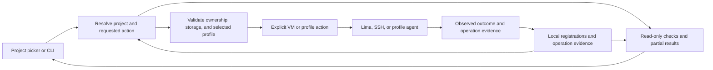
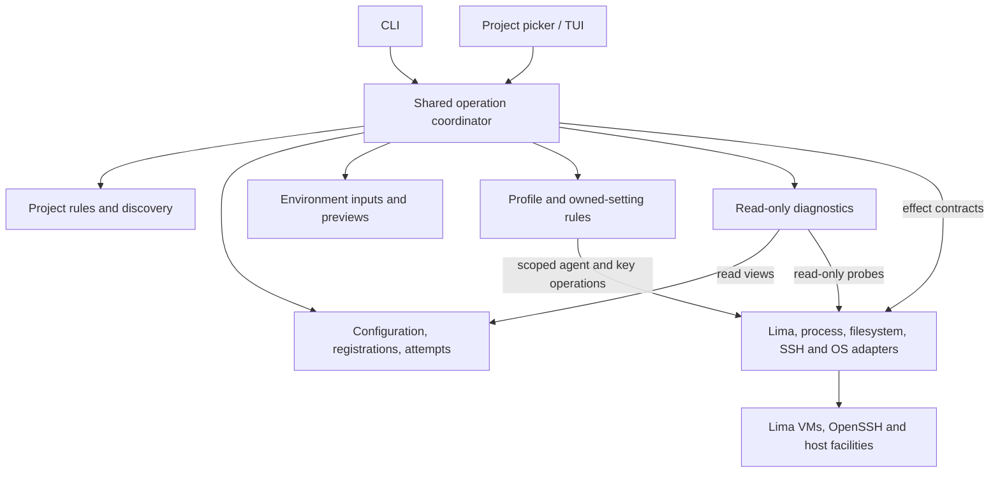

# easy-lima: implementation design

- **Author:** George Uche-Umeh
- **Status:** V1 experience approved on 2026-11-19. Fresh Goldfish design review completed; substantive findings remain open in [the consolidated report](consolidated_review_report.md). All nineteen initial findings have applied design/document corrections. The author approved the exact interface contract on 2026-11-19; the independent final re-review is in progress. Implementation and runtime qualification have not begun.
- **Date:** 2026-11-18
- **Updated:** 2026-11-19
- **Inputs:** [Approved feature scope](FEATURES.md), [concept brief](concepts_brief.md), and [resolved Goldfish review](goldfish_review_report.md).

The author accepted all 11 concept-review findings and requested implementation design on 2026-11-18. This draft carries those decisions forward into component contracts, configuration and state, storage, connections, recovery, dependencies, a file-by-file implementation plan, and validation gates. The approved product scope remains the baseline.

The author approved the opening sections and authorized the technical plan on 2026-11-18. T1 through T6 are author-selected decisions. T7 and internal parts of T8–T14 are selected under the delegation below. The author has accepted T8 optional remembering and automatic profile reuse. The draft is complete; the author approved the consolidated user-facing details on 2026-11-19 and authorized the fresh Goldfish review. No runtime validation is claimed.

**Decision authority:** On 2026-11-18 the author asked the assistant to use its best recommendation for anything that does not directly affect the user interface and experience. Choose internal mechanisms and dependencies, record their rationale and validation requirements, and continue without asking the author to compare backend alternatives. Bring back decisions about commands, prompts, defaults, visible behavior, installation requirements, credential unlocking, or recovery actions. This delegation preserves the accepted product policies and does not authorize implementation, installation, or changes to existing VMs and credentials during design.

## Overview

easy-lima is a standalone, installable application for developers who want a persistent Ubuntu development VM associated with a project folder. Running `easy-lima` opens a nested project browser rooted at the current working directory. An explicit path selects another root, and direct CLI operations support scripting. Any folder can be selected, including a repository, subfolder, or grouping folder. Selecting a grouping folder creates one VM for that selection.

The developer chooses storage deliberately, inspects the proposed environment, optionally assigns a Git identity profile, and connects through SSH or VS Code. Moving between working directories preserves registrations and settings. Moving a registered project uses explicit rebinding and preserves its VM, disk, and SSH alias.

Lima supplies the VM mechanisms and native configuration. easy-lima supplies project selection and registration, storage safeguards, optional identity profiles, and understandable lifecycle and recovery workflows. The public application works independently of a source checkout, Makefile, or prescribed workspace layout. macOS and Linux are the approved initial host families; Ubuntu is the selected guest for initial qualification. Exact supported combinations must be established during design and validation.

Implementation design starts by assessing suitable prototype behavior, code, tests, and provisioning knowledge for reuse. Fresh implementation is appropriate where it offers a clear advantage in distribution, portability, maintainability, or testing. The author selected Go for the host application, retaining suitable scripts and test scenarios. The prototype's internal structure does not determine the new component boundaries.

## The Problem

Developers need Linux environments that support their project tools and remain accessible through familiar editors. A repeatable VM workflow also needs deliberate disk placement, persistent project associations, and credentials that match the intended work or personal account. Managing those conventions manually makes it easy to allocate large files on an unintended drive, offer the wrong identity, or lose track of an environment when a folder moves.

The existing helper provides experience with this workflow on one Mac. Making it usable by other developers requires explicit configuration, installable distribution, and tested host support. Its machine-specific assumptions and path-derived instance identities cannot define the public application's behavior.

Persistent resources make failure handling part of the core product. A stopped observation may leave provisioning active. An interrupted adoption may leave ownership uncertain. A missing external drive may hide a VM that still exists. The application must retain enough evidence to distinguish these cases, preserve the existing environment, and explain the next action. Trustworthy partial information is more useful than a single misleading success or failure label.

## Goals

The release checks in [FEATURES.md](FEATURES.md#release-acceptance-checks) remain the acceptance baseline. The following goals organize those requirements for the technical design.

1. **Install and select projects without workspace assumptions.** A user on a supported host can install the binary and launch it from any directory. Lazy tree navigation supports folders at any depth, filtering, and visible VM status. Direct CLI operations provide the same capabilities, structured listings, and useful exit statuses without unexpected interactive prompts. Settings and registrations survive changes of working directory. (F1–F2)

2. **Preserve each registered environment through its lifecycle.** Start, stop, restart, inspect, and confirmed deletion operate on the associated VM. Rebinding preserves its disk and connection alias and rejects conflicts. Conflicting operations cannot overlap. Retries reconcile the recorded attempt and reuse its VM and inputs; unresolved state stops with recovery instructions. Deletion preserves the host checkout, and uninstall preserves VMs by default. (F3; GF-04, GF-07)

3. **Make environment contents and changes deliberate.** Ship a tested Ubuntu LTS base and a limited optional development preset for Snap, LXD, and Juju. Support native Lima configuration within documented boundaries. Show provisioning and resource choices before creation, retain resolved inputs and provisioning revisions, and distinguish settings that require restart or recreation. Updating easy-lima or starting an existing VM does not upgrade its tools or presets. Environment changes require an explicit update action and a preview. (F4; GF-03)

4. **Make storage placement and consumption understandable.** New and adopted VMs share one configured storage root. Missing storage causes a clear failure without fallback allocation or automatic moves. Before creation, assess downloads, temporary files, cache, and VM allocation together wherever they share capacity. Show actual allocation, disk maximum, cache location, and running VM CPU/RAM totals. Future VM growth remains explicitly unreserved. (F5; GF-02, GF-09)

5. **Connect through familiar development tools with visible access boundaries.** Provide a stable SSH alias, shell access, VS Code opening at `/workspace`, and guest commands that return their exit status. Share the selected source folder and expose additional paths or localhost ports only deliberately. Preserve user SSH entries and show the paths and ports made available to each environment. (F6)

6. **Keep project identities explicit and separate.** A VM has zero or one selected profile. Profiles supply explicit Git metadata, SSH authentication, and commit/tag signing while private keys remain on the host. Reject registered parent/child overlaps with different profiles. Profile administration is independent of VM startup, changes only owned settings, and reports conflicts with user edits. Missing credentials never cause fallback to another identity. Checks identify the repositories examined and compare GitHub authentication against the configured expected account. (F7; GF-01, GF-06)

7. **Explain failures without making implicit repairs.** Read-only diagnostics return useful local information even when dependencies or individual records are unavailable. VM readiness, agent readiness, forwarding, signing, transport/authentication, and expected-account verification have separate results. Operational logs retain useful evidence by default with known secrets excluded; saving raw output requires opt-in. Repairs are separate, explicit actions. (F8; GF-08, GF-10)

8. **Adopt the existing prototype environment without losing its usable setup.** Explicit adoption preserves the disk, instance name, SSH alias, and complete identity setup. It backs up affected metadata and establishes exclusive ownership before easy-lima mutates the instance. Interrupted handoffs remain recoverable. Conflicting ownership, storage roots, and unsafe downgrades are rejected. Unknown provisioning history leads to diagnosis. (F9; GF-02, GF-03, GF-05, GF-06)

9. **Make the release supportable by other developers.** Define versioned configuration, installation and removal procedures, recovery instructions, examples without personal data, a license, release notes, and a tested compatibility matrix. Preserve or explicitly reject custom configuration rather than silently discarding it. Publish only host/preset combinations that pass the relevant workflow checks. (F9)

## Non-Goals

- Replacing Lima's VM engine, introducing a competing-provider abstraction, or building a new provisioning language or package marketplace.
- Providing compatibility launchers for `make local`, requiring the old workspace layout, or automatically managing unrelated Lima instances.
- Multiple environments per project, branch/worktree environments, disposable VMs, or automatic idle shutdown in v1.
- Automatic storage relocation, per-VM storage pools, disk shrinking, snapshot/clone controls, or reserving capacity for future workloads.
- Automatic tool/preset upgrades, arbitrary guest-script rollback, or fully locked package builds.
- Windows/WSL, remote hosts, cross-architecture emulation, nested hardware VM guarantees, or every guest distribution and Lima driver in the first release.
- Automatic GitHub key registration, live profile switching, hardware-key integrations, or credential distribution to teams.
- A security boundary for hostile workloads. A guest can change writable mounted source and use its forwarded identity; private-key custody on the host does not remove that access.
- Workshop integration, additional automated editor launchers, and guest-native checkout synchronization in v1. These remain later candidates in the [feature scope](FEATURES.md#what-comes-later).

## Review Findings and Validation Boundaries

Internal design choices are selected under the author's delegation. The author approved the consolidated public experience on 2026-11-19. The fresh design review is complete with open findings; implementation evidence remains a separate gate.

| Area | Status and next action |
| --- | --- |
| Public experience | [UX_PROPOSAL.md](UX_PROPOSAL.md) approved on 2026-11-19: commands, TUI flows, prompts, defaults, installation/support targets, and license. Review findings may identify changes, but do not silently replace those accepted choices. |
| Internal design | T1–T14 select the architecture and dependencies. The remaining internal contracts are specified in the linked supplements. Corrections follow the existing delegation and await independent re-review; exact public syntax/results remain a proposal. |
| Compatibility and implementation evidence | Execute the planned driver, Lima, host, credential, workload, and interruption checks during implementation. Listed versions are qualification targets, not certified support. A failed contract requires a documented design correction before release. |
| Fresh review | All five stages and nine reviewer runs completed. [The consolidated report](consolidated_review_report.md) records open findings and applied corrections. The resolved concept review remains unchanged. |

## Critical User Journeys

### CUJ 1: Create and return to a project environment

- **Given:** The application is installed on a supported host, a storage root is configured, and a selected folder has no registration. The folder may be a repository, subfolder, or grouping folder.
- **When:** The user selects it in the current-directory tree or supplies its path, reviews the proposed environment, and requests creation.
- **Then:** Capacity and ownership checks precede downloads and allocation. The registration identifies one VM, its recorded creation inputs, and a stable SSH alias. The selected source appears at `/workspace`. A later start from another directory finds the same VM. Updating the application does not change that VM's installed tools.

### CUJ 2: Work with separate identities

- **Given:** Two explicitly configured profiles have distinct keys, metadata, and expected accounts. Their registered source trees do not overlap.
- **When:** The user connects to a VM assigned to one profile and checks authentication and signing.
- **Then:** Only that profile's identity is offered; checks report their individual results and the repositories examined. A new VM using an established profile is configured for Git authentication and signing automatically, without another key or setup prompt when the agent or remembered credential is usable. The flow restores the selected agent when needed; it does not require a separate profile-unlock command in the normal case. An unavailable GitHub service leaves account verification unverified. Profile administration does not start VMs or affect unrelated profiles. Attempting a parent/child registration with different profiles reports the conflict before changing assignments.

### CUJ 3: Recover after interruption or missing storage

- **Given:** Creation, provisioning, or connection checking was interrupted, or the selected drive is unavailable.
- **When:** The user inspects the project, runs diagnostics, or requests a retry.
- **Then:** Readable local registration and operation evidence remain visible. Diagnostics do not start or repair the VM. A retry first reconciles the prior attempt and uses its existing VM and recorded inputs. Active work is not duplicated; unknown state stops with recovery instructions. Missing storage never causes fallback allocation.

### CUJ 4: Move or adopt an existing environment

- **Given:** A registered project has moved, or a prototype instance is eligible for adoption under the selected storage root.
- **When:** The user requests an explicit rebind or adoption.
- **Then:** Conflicts are rejected before changes. The original instance, disk, and SSH alias survive. Adoption previews a graceful stop, proves legacy work has ended, backs up metadata and establishes exclusive ownership before new management begins. It restores a previously running VM only after verified handoff and supported recorded startup; an already-stopped VM stays stopped. Its complete identity setup is preserved. An interrupted action retains enough evidence to recover the same instance. Rebinding and adoption are distinct operations even though both preserve existing resources.

### CUJ 5: Change the guest environment deliberately

- **Given:** A registered VM has recorded template inputs and an applied provisioning revision.
- **When:** The user requests an environment update and reviews its preview.
- **Then:** The preview describes the intended changes and known restart or recreation requirements without mutating the guest. Applying the update is explicit. Interrupted work resumes the recorded attempt after reconciliation. An ordinary start or binary upgrade never substitutes the current preset for the recorded environment.

## Technical Plan

### Required responsibilities and flow

The approved requirements establish the following information flow. T1 and T2 select Go and a foreground operation coordinator; the component layout assigns responsibilities. T3–T14 specify the adapter, persistence, profile supervision, storage, recovery, interfaces, and release contracts.

The diagnostic path must remain useful when a runtime dependency is unavailable. The action path retains its association and intended inputs across interruption. Both interfaces enforce the same accepted rules through shared typed operations and the persistent claims/evidence model specified below.

### Prototype reuse assessment

This assessment is based on reading the prototype source and test cases. No VM, agent, provisioning script, or test suite was executed for this drafting step. The locations below are evidence references; they are not runtime dependencies of the new application.

| Existing implementation | Reuse candidate | Change required by the approved scope |
| --- | --- | --- |
| [DirectoryTree](/Volumes/Nebula/dev/Canonical/local/.local-launcher/tui.py:11) | Lazy directory enumeration, expanded-node state, cycle avoidance, and the related test cases. | Remove coupling to the original workspace and path-derived VM names. Preserve partial errors and separate discovery from execution. Go or Rust would port this behavior; Python could extract suitable code. |
| [Atomic writes and SSH include preservation](/Volumes/Nebula/dev/Canonical/local/.local-launcher/local.py:52) | Same-directory temporary writes, restrictive file permissions, backups, and preservation of user SSH configuration and symlinks. | Design multi-record recovery and ownership of edited settings explicitly. A single-file atomic replacement alone does not complete adoption or rebind recovery. |
| [Project naming and Manager](/Volumes/Nebula/dev/Canonical/local/.local-launcher/local.py:79) | Lifecycle and conflict scenarios, plus examples of Lima invocation. | Replace path-derived authority and workspace-local registration assumptions. Keep adopted instance names as recorded bindings. Separate readable metadata from checks that require live Lima or storage. |
| [Identity helpers](/Volumes/Nebula/dev/Canonical/local/.local-launcher/git_identity.py:21) and [guest configuration](/Volumes/Nebula/dev/Canonical/local/.local-launcher/git-guest.py:29) | Public-only guest payloads, exact-key checks, and authentication/signing behavior. | Replace the single hard-coded agent/profile and macOS-only administration. Track settings owned by the application; unconditional Git setting replacement is insufficient for user-edit conflicts. |
| [Signing and account checks](/Volumes/Nebula/dev/Canonical/local/.local-launcher/git-check.py:15) | Test scenarios for author/committer identity, forwarded keys, signed commits/tags, and expected GitHub account. | Split the results by failure layer. The existing disposable-repository signing probe writes temporary data; the technical plan must define its relationship to the accepted read-only diagnostic boundary before reusing it. |
| [Guest provisioning](/Volumes/Nebula/dev/Canonical/local/.local-launcher/provision.sh:1) and [provision dispatch](/Volumes/Nebula/dev/Canonical/local/.local-launcher/local.py:378) | Package/workload knowledge, script-input handling, and checks before LXD setup steps. | Separate the base, development preset, and explicit Docker/language extras. Replace current-script-hash-driven updates with recorded revisions and explicit environment updates. Treat existing guest logs as potentially sensitive. |
| [Lifecycle tests](/Volumes/Nebula/dev/Canonical/local/.local-launcher/tests/test_local.py:16) and [identity tests](/Volumes/Nebula/dev/Canonical/local/.local-launcher/tests/test_work_git.py:18) | Cases for unrelated-instance protection, missing storage, SSH preservation, private-key exclusion, and identity isolation. | Retain the intended guarantees, not assertions for superseded behavior such as path-derived identity or a single global profile. These tests do not establish the new interruption, adoption, or platform guarantees. |

The assessment supports selective reuse but does not make the existing host language mandatory. Registration, profile administration, environment revision handling, and recovery require substantial changes under all three options. Shell snippets and guest-side checks can be evaluated independently of the host application's language; any required guest interpreter must be part of the documented preset.

### Upstream integration evidence

The following documented interfaces constrain this design. They supply upstream evidence, not runtime qualification of the assembled application.

- Lima documents `LIMA_HOME` for its instance home. Cache and temporary-file placement still require version-specific investigation; the application must not assume that selecting the instance root controls every creation destination. [Lima environment variables](https://lima-vm.io/docs/config/environment-variables/).
- The public CLI supports noninteractive use through `--tty=false`, separate creation/start operations, and guest command execution. These are candidates for the wrapper's integration boundary. [Lima usage](https://lima-vm.io/docs/usage/).
- Instance listing supports structured JSON. The adapter must validate the supported output shape and retain unknown/unavailable distinctions instead of parsing display tables. [Lima list reference](https://lima-vm.io/docs/reference/limactl_list/).
- Lima's `show-ssh` reference marks that command deprecated and points to its generated `ssh.config` with `ssh -F`. The connection design must preserve Lima's connection settings and add only the application-owned profile/alias configuration. [Lima SSH reference](https://lima-vm.io/docs/reference/limactl_show-ssh/).

T3 separately selects the installed Lima CLI boundary, explicit version compatibility, and classified failures. The host-language decision does not imply linking Lima as a Go library.

### Contract map

Read this document for architecture, scope and implementation order. [TECHNICAL_DETAILS.md](TECHNICAL_DETAILS.md) contains component contracts; [DECISIONS.md](DECISIONS.md) contains the alternatives and evidence. Focused supplements define [profile transitions](PROFILE_TRANSITIONS.md), [external agents](ADOPTED_AGENTS.md), [Lima boundaries](LIMA_BOUNDARIES.md), [adoption](ADOPTION.md), [provisioning](PROVISIONING.md), and [state publication/restore](STATE_CONTRACT.md). The approved exact public contract is [INTERFACE_V1.md](INTERFACE_V1.md).

### Component map

These are the component responsibilities for the accepted execution model, with candidate package locations. They are not files created by this draft or a public Go SDK. Supporting code would live under `internal/`, with a small executable entry point; Go documents this arrangement for commands with supporting packages. [Go module layout](https://go.dev/doc/modules/layout).

| Component / candidate location | Responsibility and boundary |
| --- | --- |
| Executable — `cmd/easy-lima` | Construct dependencies, select CLI/TUI mode, and establish the foreground process context. VM lifetime and profile-agent lifetime are independent of this command. No lifecycle or identity rules live in argument dispatch. |
| Interfaces — `internal/ui` | CLI parsing, noninteractive confirmation requirements, TUI navigation, progress display, structured output, and exit-code mapping. Both submit the same typed requests and render the same results. Neither writes registrations nor calls a VM or credential command directly. |
| Operations — `internal/app` | Coordinate create/start/stop/delete, rebind, adoption, environment updates, and explicit profile actions. Acquire coordination rights, reconcile previous attempts, validate prerequisites, retain intent before effects, and record observations. Profile-only actions do not enter a VM-start workflow. |
| Project rules — `internal/project` | Lazy directory discovery, project/path resolution, and parent/child overlap checks. Keep the selected path distinct from persistent registration and instance identifiers. It cannot allocate a VM or repair a record during browsing. |
| Configuration and state — `internal/state` | Versioned configuration access, registrations, ownership, applied-environment references, attempt evidence, and the coordination mechanism. Expose read views separately from mutations and preserve readable records when another record is invalid. T4 selects SQLite as authoritative state with a separate diagnostic-only recovery inventory. T5 fixes the configuration layout; T6 develops concrete schemas and transaction boundaries. Detailed locking and recovery contracts must be verified before implementation. |
| Environments — `internal/environment` | Interpret template/preset selections, describe required resources and scripts, retain resolved inputs, and compute changes for an update preview. Existing VMs use their recorded revision. This component prepares work; invoking it does not implicitly install or upgrade anything. |
| Identities — `internal/identity` | Validate explicit profile metadata, key references, profile-specific agent state, and managed guest identity changes. Define only the intended changes to owned settings and report user-edit conflicts. Credentials remain on the host; unrelated profiles and VMs are unaffected. |
| External adapters — `internal/host` | Contain the Lima adapter, process execution, filesystem/capacity inspection, SSH/editor connections, and OS-specific credential/agent integration. Each adapter implements a narrow contract required by its caller. T3 selects the installed Lima CLI; host-specific behavior must satisfy its compatibility contract. |
| Diagnostics — `internal/diagnostics` | Combine local records and read-only adapter observations into independent check results. It has no start, provision, repair, or agent-initialization capability. Missing dependencies and malformed records produce partial results. T9 uses an in-memory signing challenge; real temporary-repository commit checks belong to explicit setup/release validation. |
| Shared values — `internal/model` | Small value types for project/profile/attempt identifiers, observed states, check results, and operation events. No filesystem access, environment-variable lookup, logging, or lifecycle decisions belong here. |

`internal/host` names a group of adapters; its individual areas need not become one large package. Feature packages receive only the capabilities they use. Interfaces are introduced around external effects and persistence, rather than around every helper function. The executable wires implementations to the operation logic; UI packages and concrete adapters do not depend on one another. User-facing types and persistent schema versions are distinct concerns.

This is a responsibility/dependency diagram. The coordinator runs in each foreground command. Lima-managed VM processes, profile SSH agents, and owned SSH tunnels have independent lifetimes. T4–T12 specify persistence and connection details; T13 selects interface libraries.

### T1: Host language and executable format

Build an installable Go executable. Port suitable prototype behavior and test scenarios; retain suitable guest scripts without a Python host-runtime dependency. Test-only Python is confined to contract harnesses. [Detailed contract](TECHNICAL_DETAILS.md#t1-host-language-and-executable-format).

### T2: Component boundaries and execution model

Run the operation coordinator in foreground commands. Lima VMs, profile agents and established identity tunnels can outlive the command. CLI and TUI share typed operations; neither owns lifecycle policy. Persistent claims and recorded evidence coordinate separate invocations. [Detailed contract](TECHNICAL_DETAILS.md#t2-component-boundaries-and-execution-model).

### T3: Lima adapter design

Use the installed `limactl` CLI as an external dependency with explicitly qualified versions/capabilities. Parse bounded observations, preserve partial results, and classify ambiguous effects before retrying. [LIMA_BOUNDARIES.md](LIMA_BOUNDARIES.md) defines namespace inputs, host-key trust and explicit port exposure. [Detailed contract](TECHNICAL_DETAILS.md#t3-lima-adapter-design).

### T4: Configuration and state persistence

Keep editable intent in TOML/native YAML and authoritative facts in SQLite. Project selection, immutable revisions, ownership and unfinished operations survive CWD changes. The recovery inventory is read-only diagnostic evidence and cannot reconstruct mutation authority. [Detailed contract](TECHNICAL_DETAILS.md#t4-configuration-and-state-persistence).

### T5: Configuration syntax, locations, and precedence

Use TOML for wrapper settings and native Lima YAML for VM inputs. Separate user settings, project requests and local identity definitions; resolve exact selected folders without ancestor discovery. New creation resolves defaults and explicit overrides; existing VMs use recorded inputs. [INTERFACE_V1.md](INTERFACE_V1.md) proposes the complete syntax. [Detailed contract](TECHNICAL_DETAILS.md#t5-configuration-syntax-locations-and-precedence).

### T6: SQLite schema, transactions, and recovery inventory

Use WAL with short immediate writer transactions, explicit checkpointing and no-write diagnostic connections. Durable claims and step records precede effects; publication failures stay visible. [STATE_CONTRACT.md](STATE_CONTRACT.md) supplies exact added tables and publication/restore representations. [Detailed contract](TECHNICAL_DETAILS.md#t6-sqlite-schema-transactions-and-recovery-inventory).

### T7: Go SQLite driver and operation state machine

Select ncruces/go-sqlite3 subject to connection-control qualification. The coordinator records intent before dispatch and distinguishes active, satisfied, not-applied, partial and unknown evidence. Reconcile before retry, retain uncertain claims, and stop with recovery guidance when the state cannot be established. [Detailed contract](TECHNICAL_DETAILS.md#t7-go-sqlite-driver-and-operation-state-machine).

### T8: Profile agents and credential unlocking

Use one independent owned SSH agent per profile, with optional remembering and automatic reuse during ordinary open/create. Never inherit ambient host identity. Credential changes cover all profile members; guest-only settings can target a subset. [PROFILE_TRANSITIONS.md](PROFILE_TRANSITIONS.md) and [ADOPTED_AGENTS.md](ADOPTED_AGENTS.md) define revisions, capabilities and migration. [Detailed contract](TECHNICAL_DETAILS.md#t8-profile-agents-and-credential-unlocking).

### T9: Connections, Git configuration, and credentials

Keep stable SSH aliases and a verified per-VM identity connection available after launcher exit. Private keys remain on the host; configure only owned guest Git/signing/transport settings. Strict trust, expected fingerprints, explicit locks and pending identity generations gate forwarding. Diagnostics never unlock or repair. [Detailed contract](TECHNICAL_DETAILS.md#t9-connections-git-configuration-and-credentials).

### T10: Storage admission, assets, and environment revisions

Use one selected VM root, including adoption, with no fallback allocation or automatic moves. Enumerate creation destinations and group shared capacity; future guest growth is unreserved. Freeze image/preset/setup inputs and change them only through explicit previewed environment updates. [PROVISIONING.md](PROVISIONING.md) defines stages, receipts and Docker/LXD composition. [Detailed contract](TECHNICAL_DETAILS.md#t10-storage-admission-assets-and-environment-revisions).

### T11: Lifecycle, rebinding, and adoption recovery

Preserve the same registration, disk and SSH alias through retries and explicit rebind. Adoption now includes the author-approved graceful stop, proven legacy-work quiescence, exclusive ownership publication and eligible restoration of prior running state. Already-stopped VMs stay stopped. [ADOPTION.md](ADOPTION.md) defines every handoff boundary and legacy test fixture. [Detailed contract](TECHNICAL_DETAILS.md#t11-lifecycle-rebinding-and-adoption-recovery).

### T12: Final state contracts, migration, and diagnostics

Metadata migration/restore are explicit maintenance actions under registry-open guards. SQLite remains authoritative; external witnesses fence inconsistent generations. Preserve complete old DB/side-file groups during a journaled restore and refuse stale authority. Independent checks return useful partial results, while operational logging excludes known secrets and raw capture stays opt-in. [Detailed contract](TECHNICAL_DETAILS.md#t12-final-state-contracts-migration-and-diagnostics).

### T13: CLI/TUI contract and application boundaries

Use Cobra and Bubble Tea with bounded asynchronous directory/status work. The approved experience is in [UX_PROPOSAL.md](UX_PROPOSAL.md). [INTERFACE_V1.md](INTERFACE_V1.md) contains the exact TOML/flag/result contract, explicitly approved on 2026-11-19. [Detailed contract](TECHNICAL_DETAILS.md#t13-clitui-contract-and-application-boundaries).

### T14: Dependencies, qualification, and release

Pin dependencies during implementation and qualify exact host/architecture/Lima combinations. The proposed native macOS VZ and Ubuntu Linux QEMU/KVM targets are not yet certified. Release only after the lifecycle, identity, preset, interruption, no-write and distribution gates below pass. [Detailed contract](TECHNICAL_DETAILS.md#t14-dependencies-qualification-and-release).

## Detailed Implementation Plan

This section records the proposed implementation worklist. The review identifies missing contracts and fixture details to add before implementation; none of these proposed files was created during drafting. Paths below are relative to this repository. The developer Makefile is only for building/testing the application; it contains no `make local` compatibility target and is not required by installed users.

### Build in this order

Prerequisite: resolve the current design-review findings and any required user-facing decisions before production implementation. Early driver/Lima qualification belongs in step 1, before dependent features; broader acceptance checks run as their components become executable. Release qualification and implementation review precede publication.

1. Establish the Go module and typed result/plan contracts. Prove SQLite connection/closure/read-only behavior and the Lima no-write/start/storage contracts in isolated test directories before feature work depends on them. A failed proof updates the selected internal mechanism and its evidence, not the accepted product guarantees.
2. Implement configuration/path rules, SQLite schema/admission, inventory export, safe files, and operation reconciliation. Exercise interruption and concurrent-controller cases before dispatching real VM effects.
3. Implement owned storage/asset planning and base VM lifecycle against a fake Lima process, then an opt-in isolated real VM. Freeze environment inputs and implement controlled setup stages.
4. Implement independent profiles, credential adapters, explicit lock/remember behavior, owned SSH aliases/tunnels, guest Git configuration, and the automatic existing-profile path. Validate real SSH and editor reconnect before calling it complete.
5. Implement rebind, environment update, prototype handoff, backup/migration/restore, and diagnostics against the same coordinator and fault-injection boundaries.
6. Implement the approved CLI/TUI proposal on the shared contracts; verify arbitrary CWD, paths with spaces, script output/exit status, cancellation, and partial results.
7. Run the host/preset/identity matrix and prepare documentation and release metadata. Complete implementation review and all release gates before publication. Revisit design review if implementation reveals a changed architectural or user-facing contract.

### File manifest

Every listed path is planned, not present unless it is one of the existing Markdown documents. Grouped paths have their individual responsibility stated in the same row. No unspecified generator may add production files without updating this manifest during implementation.

| File(s) | Change and responsibility |
| --- | --- |
| `go.mod`, `go.sum` | Create module/toolchain selection and exact direct/transitive dependency locks. |
| `Makefile` | Create developer build, format, vet, unit/integration, contract, host-acceptance, and release targets; no runtime compatibility launcher. |
| `.gitignore` | Extend for build/test artifacts and private scratch/state; never ignore relevant source or fixtures. |
| `cmd/easy-lima/main.go` | Create composition root, signal handling, exit mapping, and CLI/private-proxy dispatch. |
| `internal/model/model.go` | Create IDs, revisions, operations, evidence classifications, plans, checks, and stable error codes. |
| `internal/config/config.go`, `internal/config/paths.go` | Create TOML schemas/validation/precedence and host-specific locations/file-relative resolution. |
| `internal/project/project.go`, `internal/project/tree.go` | Create resolved source identity/overlap rules and lazy cancellable directory enumeration. |
| `internal/state/sqlite/store.go`, `internal/state/sqlite/connections.go` | Create typed persistence queries/transactions and separately configured physical read/write/maintenance connections. |
| `internal/state/sqlite/migrations/0001_initial.sql` | Create schema, references, constraints, and indexes including profile runtime, connection, capacity, and ownership-epoch records. |
| `internal/state/sqlite/maintenance.go` | Create explicit backup, migration, checkpoint, and recoverable restore-swap logic. |
| `internal/state/inventory.go`, `internal/state/guards.go` | Create generation-checked outbox publication and existing-file OS guards/admission barriers. |
| `internal/app/coordinator.go`, `internal/app/reconcile.go` | Create shared plan/admission/effect dispatch, evidence recording, cancellation, and workflow-specific reconciliation. |
| `internal/app/lifecycle.go`, `internal/app/environment.go` | Create up/start/stop/restart/delete orchestration and explicit preview/apply of frozen environment changes. |
| `internal/app/rebind.go`, `internal/app/adopt.go` | Create source-binding transitions and supported prototype handoff with backups/exclusive ownership checks. |
| `internal/app/profiles.go`, `internal/app/maintenance.go` | Create independent profile operations/activation and metadata maintenance workflows. |
| `internal/host/process/process.go` | Create argv-based process execution, bounded observation, streaming/capture separation, and allowlisted classified errors excluding known credential values and raw subprocess details. |
| `internal/host/files/files.go`, `internal/host/files/volume_darwin.go`, `internal/host/files/volume_linux.go` | Create safe owned-file replacement/backup, mount/file identity, APFS shared-capacity inspection, and Linux filesystem/quota observations. |
| `internal/host/lima/adapter.go`, `internal/host/lima/contract.go`, `internal/host/lima/config.go` | Create the installed-CLI adapter, exact version/capability table, parsed observations, namespace manifest/admission, explicit-port suppression and owned native-YAML validation/patching. |
| `internal/host/lima/config_test.go` | Test namespace input absence/drift/unsupported overlays, resolved rule ordering and address/protocol exposure boundaries. |
| `internal/storage/planner.go`, `internal/storage/assets.go` | Create destination/peak-capacity ledger and bounded verified asset materialization/reference tracking. |
| `internal/environment/environment.go`, `internal/environment/provision.go` | Create frozen image/template/preset revisions, update diffs, explicit guest-stage dispatch, receipts, and postconditions. |
| `internal/identity/profile.go`, `internal/identity/agent.go`, `internal/identity/settings.go` | Create ownership-derived agent capabilities, profile validation/runtime lock policy, external-agent refusal and owned migration checks, fingerprint-bound agent operations, and scoped public guest Git/SSH bundles. |
| `internal/host/agent/agent.go`, `internal/host/agent/launchd_darwin.go`, `internal/host/agent/systemd_linux.go`, `internal/host/agent/detached_linux.go` | Create host agent lifecycle interface and owned native supervision/fallback adapters. |
| `internal/host/credential/credential.go`, `internal/host/credential/keychain_darwin.go`, `internal/host/credential/keychain_darwin.h`, `internal/host/credential/keychain_darwin.m`, `internal/host/credential/secretservice_linux.go` | Create secret-store results/no-dialog contract, narrow macOS native binding, and Linux existing-session Secret Service implementation. |
| `internal/connection/connection.go`, `internal/connection/aliases.go`, `internal/connection/tunnel.go`, `internal/connection/proxy.go` | Create verified runtime endpoints, conflict-aware SSH fragment management, stable owned forwards, and private byte-proxy entry point. |
| `internal/connection/trust.go`, `internal/connection/trust_test.go` | Create recorded VM TOFU/imported-pin enrollment, strict managed transports, generation-bound trust exports, and mismatch/interruption/read-only checks. |
| `internal/diagnostics/diagnostics.go`, `internal/diagnostics/identity.go` | Create partial read-only check aggregation, effective identity inspection, in-memory signing probe, and bounded provider verification. |
| `internal/events/events.go` | Create allowlisted operational events, retention, raw-capture exclusion, and CLI/TUI progress mapping. |
| `internal/ui/cli/cli.go`, `internal/ui/cli/render.go` | Create proposed command/flag grammar, noninteractive rules, structured output, and text/exit rendering. |
| `internal/ui/tui/model.go`, `internal/ui/tui/update.go`, `internal/ui/tui/view.go` | Create browser/actions/preview/progress state, asynchronous coordinator dispatch, and accessible terminal rendering. |
| `assets/embed.go`, `assets/catalog.json`, `assets/ubuntu-24.04.yaml` | Create embedded release assets, immutable publisher image/bounds manifest, and native base VM configuration. |
| `assets/presets/base.sh`, `assets/presets/development.sh`, `assets/presets/docker.sh` | Create individually versioned, explicit setup stages with testable postconditions; never unconditional every-boot upgrades. |
| `assets/guest/stage-runner.py`, `assets/guest/signing-wrapper.sh`, `assets/guest/runtime.conf.tmpl` | Create safe stage receipts/streaming, stable-socket SSH signing, and private guest runtime-directory setup. |
| `assets/github-known-hosts` | Create independently verified public provider host keys with documented provenance/update procedure. |
| `internal/config/config_test.go`, `internal/project/project_test.go` | Test precedence/invalid fields, arbitrary CWD, symlink/case identity, and parent/child conflicts. |
| `internal/state/sqlite/store_test.go`, `internal/state/sqlite/maintenance_test.go`, `internal/state/inventory_test.go` | Test transactions/constraints, physical-connection checkpoint/read-only gates, consistent backup/restore, and publication crash/race behavior. |
| `internal/app/recovery_test.go`, `internal/app/adopt_test.go`, `internal/app/rebind_test.go` | Test effect/commit interruption, stale controllers, legacy ownership retirement, and old/candidate/third-value recovery. |
| `internal/storage/planner_test.go`, `internal/connection/connection_test.go`, `internal/identity/profile_test.go` | Test shared-capacity/concurrent admissions, alias/socket ownership/reconnect, and profile activation/lock/remember isolation. |
| `internal/diagnostics/diagnostics_test.go`, `internal/ui/cli/cli_test.go`, `internal/ui/tui/tui_test.go` | Test no-repair partial results, exact script output/exit contracts, and navigation/preview/cancellation behavior through shared operations. |
| `internal/testsupport/fakes.go`, `internal/testsupport/faults.go` | Create deterministic external-effect fakes and interruption points; avoid tests that simply mirror private methods. |
| `testdata/contracts/lima-2.2.1.json`, `testdata/scenarios/recovery.json` | Create redacted upstream output fixtures and shared failure/retry scenarios. No real identity or private machine paths. |
| `internal/state/publication.go`, `internal/state/publication_test.go`, `testdata/state/publication-v1.json` | Implement exact local/namespace publication, marker/restore admission, crash boundaries and no-inventory-authority fixtures from STATE_CONTRACT.md. |
| `internal/environment/stages.go`, `internal/environment/stages_test.go`, `testdata/provisioning/stages-v1.json`, `testdata/provisioning/reconciliation-v1.json`, `testsupport/guest/test_stage_runner.py` | Implement stage graph, typed receipts, controlled runner output and satisfied/active/not-applied/partial/unknown decisions from PROVISIONING.md. |
| `testdata/prototype/local-launcher-v1/local.py`, `testdata/prototype/local-launcher-v1/manifest.json`, `testdata/prototype/local-launcher-v1/README.md`, `testdata/prototype/scenarios.json` | Retain the unaltered digest-pinned supported legacy source, provenance and synthetic active/retired/conflicting record cases. No production import or real user data. |
| `testsupport/prototype/driver.py`, `testsupport/prototype/fake_runtime.py`, `internal/app/adopt_contract_test.go` | Execute the real legacy ownership/start/stop/delete paths behind isolated fake host boundaries, with positive controls and zero-mutation refusal assertions. Python 3.11+ is test-only, never an installed-binary dependency. |
| `internal/ui/cli/contracts_test.go`, `testdata/interface/v1/cases.json`, `testdata/interface/v1/expected-results.json`, `testdata/interface/v1/user-valid.toml`, `testdata/interface/v1/project-valid.toml` | After interface approval, verify exact public fields, valid/rejected inputs, noninteractive secret input, mixed status/exit cases and complete command-family results. |
| `tests/acceptance/acceptance_test.go`, `tests/contracts/contracts_test.go` | Create opt-in isolated real-host lifecycle/workload/editor tests and low-level dependency/no-write/capacity traces. Require explicit test-owned storage; never discover and mutate the user's current VMs. |
| `.github/workflows/ci.yml`, `.github/workflows/release.yml`, `.goreleaser.yaml` | Create normal checks and native, gated artifact/signing/release automation with declared external credentials and compatibility results. |
| `LICENSE`, `NOTICE`, `CONTRIBUTING.md`, `SECURITY.md`, `CHANGELOG.md` | Create approved license/provenance, contribution/test instructions, vulnerability-reporting instructions, and versioned change records. |
| `README.md`, `FEATURES.md`, `concepts_brief.md`, `design_draft.md`, `UX_PROPOSAL.md`, `PROFILE_TRANSITIONS.md`, `ADOPTED_AGENTS.md`, `LIMA_BOUNDARIES.md`, `ADOPTION.md`, `PROVISIONING.md`, `STATE_CONTRACT.md`, `INTERFACE_V1.md`, `TECHNICAL_DETAILS.md`, `DECISIONS.md` | Update implemented-versus-proposed status and decision references and normative profile, adopted-agent and Lima boundary contracts as work ships; preserve the closed review history. |
| `docs/install.md`, `docs/configuration.md`, `docs/profiles.md`, `docs/storage.md`, `docs/recovery.md`, `docs/adoption.md`, `docs/compatibility.md` | Create user installation/removal, exact TOML examples, one-time profile/key registration, actual storage locations, explicit recovery, supported handoff, and tested host/Lima contracts. |
| `examples/easy-lima.toml`, `examples/profile.toml`, `examples/lima.yaml` | Create shareable public examples using placeholders, deliberate paths, and no personal/work identity defaults. |

### Verification and release gates

| Gate | Required evidence |
| --- | --- |
| Build and static checks | `make build`, `make fmt-check`, and `make vet`; native macOS credential bridge plus Linux binaries. Record exact toolchain/module/SQLite engine versions and vulnerability/license scan results. |
| Unit/integration behavior | `make test` and race-enabled applicable suites; real SQLite files, two processes, side-file tracing, ambiguous commits, claim admission, export generations, and restore interruption. |
| Dependency contracts | `make test-contracts` in disposable directories, with Python 3.11+ for the pinned legacy and guest-runner harnesses only. Prove no-close-checkpoint, no-write reads, SQLite backup consistency, Lima observation side effects, missing-instance refusal, local-asset/no-external-large-write behavior, and native-YAML edit semantics, namespace-only drift refusal and explicit TCP/UDP catch-all suppression. |
| Real host lifecycle | `make test-acceptance` with explicit test root/host matrix. Fresh install, arbitrary CWD, nested/grouping folders, source edits, preserved guest data, stop/start/rebind/delete, unavailable volume, and two concurrent VMs. |
| Identity experience | First and second VM use the same expected profile key without another setup step; stopped/empty agent with remembered credential; explicit lock; denied/unavailable store; two simultaneous requests; profile-free independence; wrong key/account; offline provider; actual SSH and VS Code signing after launcher exit/reconnect; external-agent capability refusal, independent migration, VM host-key enrollment and post-enrollment mismatch rejection. |
| Preset workloads | Base, development, Docker-only and combined presets on each advertised native host/architecture. Verify Snap confinement, LXD storage/networking, Docker networking and a disposable Juju LXD bootstrap/deploy/cleanup. Repeat combined networking after Docker restart, LXD restart and VM reboot. Record actual versions and peak disk allocation for asset/preset bounds. Nested hardware VMs are not claimed. |
| Failure recovery | Inject interruption before dispatch, after external effects, before/after commits, during rebind/adoption, and during restore swap. No duplicate VM, lost ownership, unsafe replay, inventory-authorized mutation, or automatic script rollback. |
| Public UX | Verify one first-create preview, direct existing-profile reuse, keyboard/tree behavior, no noninteractive dialogs, exact `exec` stdout/exit behavior, approved interface fixtures and mixed-result precedence, classified partial results, and explicit update/repair/delete confirmations. |
| Distribution | Install archives/formula on clean supported hosts without a checkout or build toolchain; upgrade binary without guest changes; uninstall while preserving VMs/profile assets; verify checksums/signing/notices. |

A test matrix entry becomes advertised support only after these checks pass. Do not convert a design target into a compatibility claim. No VM, credential, dependency build, or runtime test was executed while writing this draft.

## Requirement traceability

This checks the draft against the approved brief and feature scope. It does not replace a fresh independent Goldfish review or executable acceptance tests. No accepted policy is intentionally changed; the author approved the consolidated user-facing additions on 2026-11-19.

| Accepted requirement | Design coverage | Required implementation evidence |
| --- | --- | --- |
| F1: standalone installation/setup | T1, T5, T13–T14; UX setup and installation | Clean-host binary/formula install, arbitrary CWD, explicit storage, no source checkout or compatibility launcher. |
| F2: nested selection and CLI parity | T2, T5, T13; UX browser and command table | Lazy tree, grouping-folder selection, direct paths, same coordinator/confirmations, predictable noninteractive behavior. |
| F3: persistent lifecycle and rebind; GF-04, GF-07 | T3, T6–T7, T11 | Same VM/alias after move or interrupted retry, no duplicate dispatch, conflicts retained, confirmed deletion preserves host files. |
| F4: native templates and explicit updates; GF-03 | T5, T10–T11 | Frozen inputs, named stage receipts, restart without upgrades, explicit update preview, shipped Snap/LXD/Juju workload checks. |
| F5: one root and shared capacity; GF-02, GF-09 | T5–T6, T10, T12 | Missing-volume refusal, no external large-file fallback, shared-capacity accounting, adoption root checks, allocated/maximum/unreserved distinctions. |
| F6: connections, mounts, ports | T3, T9–T11, T13; UX SSH/editor/forward flows | Actual editor reconnect, source visibility, distinct host ports across VMs, host-key checks, preserved guest command exit status. |
| F7: one optional profile and owned changes; GF-01, GF-06 | T5–T9, T11–T12 | Expected identity only, both overlap directions, no host Git edits, owned-file conflicts, profile-free independence, complete adopted identity preserved. |
| Accepted existing-profile experience | T8–T9; UX profile flow | First Git use in another VM works with the same loaded/remembered key, no per-VM setup, explicit lock respected, no hidden noninteractive dialogs. |
| F8: reconciliation and read-only partial diagnosis; GF-07, GF-08 | T3, T6–T7, T9, T11–T12 | Failure injection, independent statuses, no diagnostic initialization/checkpoint/repair, unknown state refuses replay. |
| F8 logging policy; GF-10 | T3, T7, T10, T12–T13 | Safe operational fields by default, opt-in raw persistence, known-secret exclusion, partial/truncated output reported. |
| F9: release/adoption; GF-05, GF-06 | T8, T11–T12, T14 | Previewed graceful stop and eligible prior-state restoration, executable legacy-refusal fixture, metadata backups and retirement, interruption matrix, no conflicting restore/downgrade owners, preserved shared legacy credentials. |
| Selective reuse; GF-11 | Reuse assessment, T1, DECISIONS.md, implementation manifest | Provenance-reviewed script reuse and behavior/scenario ports; source review alone never counted as runtime success. |

The draft adds concrete internal dependencies, a per-VM SSH tunnel, explicit asset materialization, maintenance protocols, and file/test ownership to the brief under the author's delegation. The command families, resource/preset defaults, installation/support targets and license in UX_PROPOSAL.md were approved on 2026-11-19. The exact supplemental field/flag/result contract in INTERFACE_V1.md was approved on 2026-11-19, applying ELD-11/ELD-12 to the design.

## Completion and review boundary

The draft addresses F1–F9 and all eleven accepted concept-review findings. The implementation-design review has identified additional enforcement gaps and incomplete contracts in the file/work/test plan; seventeen have applied corrections and the remaining two public-contract findings have author approval in INTERFACE_V1.md. The public experience in [UX_PROPOSAL.md](UX_PROPOSAL.md) was approved on 2026-11-19. That approval does not claim runtime validation or authorize changes to live resources during this review.

The fresh implementation-design Goldfish review is complete; [the consolidated report](consolidated_review_report.md) records open findings and applied documentation corrections against its frozen input. Resolve the substantive findings and obtain decisions on changed public behavior before production implementation. The qualification gates above remain implementation/release work. Publishing, registering keys, or modifying the user's live prototype/VMs requires the corresponding explicit action; this review performs none of those operations.

*Drafted with EGM.*
